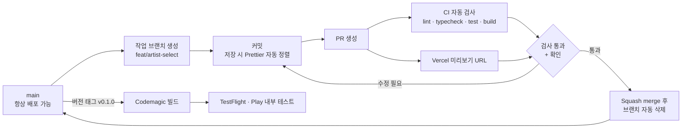

# 개발 환경 설정 및 GitHub 운영 가이드

작성일: 2026-10-06 · 관련 문서: [공연캘린더_취향매칭앱_기획서.md](공연캘린더_취향매칭앱_기획서.md) 3장(툴 체계·충돌 방지 규칙)

개발 PC(Windows 11)에 남은 설치는 pnpm, GitHub CLI, Android Studio 세 가지이고, **Java는 PC에 깔린 26 대신 Android Studio 내장 JDK를 쓰도록 고정**해야 한다. GitHub는 레포 하나에 앱·DB·문서를 모두 넣고, main 보호 + 짧은 기능 브랜치 + PR 자동 검사로 충돌을 막는다.

## 1. 현재 PC 점검 결과 (2026-10-06)

| 도구 | 상태 | 조치 |
| --- | --- | --- |
| Git | 2.54 설치됨 | 2장의 전역 설정만 추가 |
| Node.js | v24 설치됨 | 유지(LTS 계열). 프로젝트에 버전 고정 |
| npm | 설치됨 | pnpm 설치용으로만 사용 |
| pnpm | 없음 | 설치 필요 |
| GitHub CLI (gh) | 없음 | 설치 필요(레포 생성·PR 관리) |
| VS Code | 설치됨 | 확장 설치 |
| Java | 26 설치됨 | **Android 빌드에는 사용 금지** → Android Studio 내장 JDK(JBR)로 JAVA_HOME 지정 |
| Android SDK 폴더 | 있음 | Android Studio 설치 여부 확인 필요(기본 경로에 없음) |
| adb | PATH에 없음 | Android Studio 설치 후 PATH 추가 |

> Java 26 주의: Capacitor·Android Gradle Plugin은 특정 JDK 버전(현재 세대는 JDK 21)을 기준으로 동작한다. 최신 Java가 기본으로 잡혀 있으면 Gradle 빌드가 실패할 수 있으므로, 시스템 Java는 그대로 두고 **JAVA_HOME만 Android Studio 내장 JDK로** 지정한다. 정확한 요구 버전은 설치 시점의 Capacitor 문서로 확인한다.

## 2. 설치 및 설정 순서

### 2.1 프로그램 설치

| 순서 | 항목 | 용도 | 단계 |
| --- | --- | --- | --- |
| 1 | pnpm | 패키지 매니저(단일 사용 규칙) | 즉시 |
| 2 | GitHub CLI | 레포 생성, PR·이슈 관리 | 즉시 |
| 3 | VS Code 확장 | 코드 규칙·자동 정리 | 즉시 |
| 4 | Android Studio | Android SDK, 에뮬레이터, 내장 JDK | 앱 패키징 단계 전 |
| 5 | Supabase CLI | DB 마이그레이션·Edge Functions 배포 | 백엔드 착수 시(프로젝트 devDependency로 설치) |
| 6 | Docker Desktop (선택) | 로컬 Supabase 실행·스키마 비교 | 필요해질 때만. 초기엔 클라우드 dev 프로젝트로 대체 |

iOS 빌드는 Codemagic(클라우드)에서 하므로 PC에 Xcode·Mac 관련 설치는 없다.

pnpm 설치:

```bash
npm install -g pnpm
```

GitHub CLI 설치:

```bash
winget install --id GitHub.cli
```

Android Studio 설치(이미 다른 경로에 있으면 생략):

```bash
winget install --id Google.AndroidStudio
```

GitHub 로그인(브라우저 인증):

```bash
gh auth login
```

### 2.2 Git 전역 설정 (Windows 줄바꿈 충돌 방지)

Windows는 줄바꿈이 CRLF라서, 설정 없이 쓰면 내용이 같아도 파일 전체가 바뀐 것으로 보여 충돌이 난다. 레포의 `.gitattributes`(4.4)로 LF를 강제하고, 전역에서는 자동 변환을 끈다.

```bash
git config --global core.autocrlf false
```

```bash
git config --global init.defaultBranch main
```

```bash
git config --global pull.rebase true
```

### 2.3 VS Code 확장

| 확장 | 이유 |
| --- | --- |
| ESLint | 코드 규칙 위반 즉시 표시 |
| Prettier | 저장 시 자동 정렬 → 서식 차이로 인한 충돌 제거 |
| Tailwind CSS IntelliSense | 클래스 자동완성 |
| EditorConfig | 들여쓰기·줄바꿈 통일 |
| Markdown Preview Mermaid Support | 기획서 흐름도 미리보기 |
| GitHub Pull Requests | VS Code 안에서 PR 확인 |

### 2.4 환경 변수

| 변수 | 값 | 비고 |
| --- | --- | --- |
| JAVA_HOME | Android Studio 내장 JDK 경로(보통 `C:\Program Files\Android\Android Studio\jbr`) | 시스템 Java 26과 분리 |
| ANDROID_HOME | `%LOCALAPPDATA%\Android\Sdk` | SDK 폴더는 이미 존재 |
| PATH 추가 | `%ANDROID_HOME%\platform-tools` | adb 사용 |

### 2.5 계정 준비

| 계정 | 용도 | 비용·시점 |
| --- | --- | --- |
| GitHub | 코드·이슈·CI | 무료, 즉시 |
| Supabase | 백엔드(dev, prod 프로젝트 2개) | 무료 플랜으로 시작 |
| Vercel | 웹 배포·PR 미리보기 | 무료로 시작, 상업 이용 조건 확인 |
| Firebase | FCM 푸시 전용 | 무료 |
| KOPIS | 공연 오픈 API 키 | 무료, 신청 필요 |
| Figma | 화면 설계 | 무료로 시작 |
| Sentry, PostHog | 오류·사용 분석 | 무료로 시작, 출시 전 |
| Codemagic | iOS·Android 빌드·스토어 업로드 | 무료 빌드 한도, 앱 패키징 단계 |
| Apple Developer Program | iOS 배포 | 연 99달러, 심사 일정 고려해 미리 |
| Google Play Console | Android 배포 | 1회 25달러, 본인 확인 기간 고려해 미리 |

## 3. 프로젝트 버전 고정 (모든 환경을 같게)

다른 PC·CI·Codemagic에서 같은 결과가 나오도록 레포 안에 버전을 적어 둔다.

| 파일 | 내용 |
| --- | --- |
| `package.json` → `packageManager` | `pnpm@<버전>` — 다른 패키지 매니저 사용 방지 |
| `package.json` → `engines` | `node: ">=24 <25"` 형태로 Node 메이저 고정 |
| `.nvmrc` | `24` — CI·Codemagic이 같은 Node 사용 |
| `pnpm-lock.yaml` | 유일한 잠금 파일. `package-lock.json`, `yarn.lock`은 생성 즉시 삭제 |
| `.env.example` | 필요한 환경 변수 이름만(값 없음). 실제 `.env`는 커밋 금지 |
| `capacitor.config.ts` | 앱 ID(`com.<회사>.<앱>` 형태, 출시 후 변경 불가)·앱 이름 |

## 4. GitHub 레포 운영 전략

### 4.1 레포 구조: 단일 레포(private)

앱 코드, DB 마이그레이션, Edge Functions, 문서를 **레포 하나**에 둔다. 프론트와 백엔드를 별도 레포로 나누면 "DB는 바뀌었는데 앱은 옛 버전" 같은 불일치가 생기기 쉽다. 한 PR 안에서 DB 변경과 화면 변경을 같이 검토·배포하면 이 문제가 사라진다.

```
duckchinso/
├─ src/                  # React 앱
├─ public/
├─ supabase/
│  ├─ migrations/        # DB 변경 SQL (시간순 파일)
│  └─ functions/         # Edge Functions (KOPIS 수집, 푸시 발송)
├─ android/              # Capacitor가 생성, 커밋함
├─ ios/                  # Capacitor가 생성, 커밋함
├─ docs/                 # 기획서·가이드 (MD)
├─ .github/
│  ├─ workflows/ci.yml   # PR 자동 검사
│  ├─ dependabot.yml
│  └─ pull_request_template.md
├─ capacitor.config.ts
├─ package.json
├─ pnpm-lock.yaml
├─ .gitattributes
├─ .editorconfig
├─ .gitignore
├─ .env.example
└─ .nvmrc
```

### 4.2 브랜치 전략: GitHub Flow

Git Flow(develop·release·hotfix 브랜치)는 소규모 팀에는 브랜치가 많아 오히려 충돌을 늘린다. **main 하나 + 짧게 쓰고 지우는 작업 브랜치**로 운영한다.



| 규칙 | 내용 | 충돌을 막는 이유 |
| --- | --- | --- |
| main 직접 푸시 금지 | 모든 변경은 PR로 | 검사 안 된 코드가 main에 섞이지 않음 |
| 브랜치는 짧게 | 1\~3일 안에 머지, 기능이 크면 쪼개기 | 오래된 브랜치일수록 main과 차이가 커져 충돌 |
| 작업 전 최신화 | 작업 시작·PR 전 `git pull --rebase origin main` | 충돌을 작은 단위로 일찍 해결 |
| Squash merge | PR 하나 = main 커밋 하나 | 이력이 단순해져 되돌리기 쉬움 |
| 브랜치 이름 | `feat/` `fix/` `chore/` `docs/` + 내용 | 목록만 봐도 작업 파악 |
| 커밋 메시지 | `feat: 아티스트 선택 화면 추가` 형식 | 변경 이력 검색·릴리스 노트 자동화 |
| 버전 태그 | 앱 출시 단위로 `v0.1.0` 태그 | 스토어 버전과 코드 버전 1:1 대응 |

혼자 개발하더라도 PR을 거친다. PR마다 CI 검사와 Vercel 미리보기가 자동으로 붙어 "내 PC에선 됐는데" 문제를 막는다.

### 4.3 main 브랜치 보호 설정 (GitHub → Settings → Branches)

- [ ] Require a pull request before merging
- [ ] Require status checks to pass (CI 워크플로 지정)
- [ ] Require branches to be up to date before merging
- [ ] Allow squash merging만 허용, merge commit·rebase merge 끄기
- [ ] Automatically delete head branches
- [ ] Settings → Code security → Secret scanning + Push protection 켜기(비밀키 커밋 차단)

### 4.4 충돌 방지용 레포 파일

| 파일 | 핵심 내용 |
| --- | --- |
| `.gitattributes` | `* text=auto eol=lf` (전체 LF 통일), `*.bat text eol=crlf`, `*.png binary` 등 바이너리 지정 |
| `.editorconfig` | 들여쓰기 2칸, LF, 파일 끝 줄바꿈 |
| `.gitignore` | `node_modules/`, `dist/`, `.env`, `.env.*`(단 `.env.example` 제외), `android/app/build/`, `android/.gradle/`, `ios/App/Pods/`, `*.jks`, `*.keystore`, `*.p8`, `*.p12`, `*.mobileprovision` |
| Prettier + ESLint 설정 | 서식은 도구가 결정 → 사람마다 다른 서식으로 생기는 충돌 제거 |
| husky + lint-staged (선택) | 커밋 직전 변경 파일만 자동 정렬·검사 |

### 4.5 충돌이 잘 나는 영역별 규칙

| 영역 | 위험 | 규칙 |
| --- | --- | --- |
| `pnpm-lock.yaml` | 두 브랜치가 각각 패키지를 추가하면 잠금 파일 충돌 | 손으로 고치지 말고 main 기준으로 맞춘 뒤 `pnpm install`로 재생성. 패키지 추가는 가능하면 별도 PR |
| DB 마이그레이션 | 두 사람이 동시에 스키마 변경 → 순서 꼬임 | `supabase migration new`로 시간순 파일 생성, **머지된 마이그레이션 파일은 절대 수정하지 않고** 새 파일로 변경. 새 마이그레이션 전 main 최신화 |
| `android/` `ios/` | 네이티브 프로젝트 직접 수정 시 큰 충돌 | 설정은 `capacitor.config.ts`로, 웹 빌드 후 `pnpm cap sync`. 네이티브 직접 수정은 별도 PR로 분리 |
| Capacitor 패키지 버전 | 코어와 플러그인 메이저 버전 불일치 → 빌드 실패 | Dependabot에서 `@capacitor/*` 패키지를 한 그룹으로 묶어 같이 업데이트 |
| 환경 변수·비밀키 | 키가 레포에 들어가면 회수 불가 | 레포엔 `.env.example`만. 실제 값은 로컬 `.env`, GitHub Secrets, Vercel·Codemagic 환경 변수에 |
| 서명 키(keystore·인증서) | 분실 시 앱 업데이트 불가 | 레포 밖 안전한 곳 2중 백업, Codemagic에 업로드해 빌드 시 사용 |
| 문서(`docs/`) | 같은 MD를 동시 수정 | 섹션 단위로 작업, 큰 개편은 PR 하나로 |

### 4.6 자동화 (GitHub Actions·Dependabot)

| 자동화 | 동작 | 효과 |
| --- | --- | --- |
| CI (`ci.yml`) | PR마다 `pnpm install --frozen-lockfile` → lint → typecheck → test → build | 깨진 코드·잠금 파일 불일치가 main에 못 들어옴 |
| Dependabot | 주 1회 의존성 업데이트 PR, Capacitor·Supabase 등 그룹 단위 | 버전이 조금씩 벌어지는 것을 방지 |
| Vercel 연동 | PR마다 미리보기 URL, main 머지 시 웹 배포 | 화면을 실제로 보고 머지 |
| Supabase 배포 (2단계) | main 머지 시 마이그레이션·Edge Functions를 prod에 반영 | DB와 앱 코드가 함께 배포됨 |
| Codemagic | `v*` 태그 푸시 시 iOS·Android 빌드 → TestFlight·Play 내부 테스트 | 출시 빌드 재현 가능 |

### 4.7 개발/운영 환경 분리

| 환경 | Supabase | 웹 | 앱 |
| --- | --- | --- | --- |
| 로컬 개발 | dev 프로젝트 | `pnpm dev` | Android 에뮬레이터 |
| PR 미리보기 | dev 프로젝트 | Vercel Preview | — |
| 운영 | prod 프로젝트 | Vercel Production | 스토어 배포 빌드 |

dev와 prod를 처음부터 분리해 두면 테스트 데이터가 실제 사용자에게 보이는 사고를 막을 수 있다.

### 4.8 이슈·작업 관리

- GitHub Issues + Projects(보드: Todo / In Progress / In Review / Done)로 작업 관리
- 이슈 하나 = 브랜치 하나 = PR 하나. PR 본문에 `Closes #이슈번호`로 자동 종료
- 라벨: `frontend` `backend` `app` `docs` `bug` `jpop-data`
- PR 템플릿 체크리스트에 "기획서 3.4 충돌 방지 규칙 확인" 항목 포함

## 5. 레포 생성부터 첫 커밋까지 순서

1. 2장 설치·설정 완료, `gh auth login`
2. 프로젝트 생성: Vite React TypeScript 템플릿 → Tailwind·ESLint·Prettier 설정
3. 4.4의 `.gitattributes`, `.editorconfig`, `.gitignore`, `.env.example`, `.nvmrc` 작성
4. 기존 `docs/` 폴더를 프로젝트 안으로 이동
5. 첫 커밋 후 private 레포 생성·푸시(`gh repo create`)
6. 4.3 main 보호 설정, Secret scanning 켜기
7. CI 워크플로·Dependabot·PR 템플릿 추가(첫 PR로 진행 → 보호 규칙 동작 확인)
8. Vercel에 레포 연결, Supabase dev·prod 프로젝트 생성 후 환경 변수 등록
9. Capacitor 추가는 웹 화면이 어느 정도 나온 뒤(앱 패키징 단계)에 진행

## 6. 미결 사항

- [ ] GitHub 계정 개인 vs Organization(팀원 합류·소유권 이전 계획이 있으면 Organization 권장)
- [ ] 앱 ID(번들 ID) 확정 — 출시 후 변경 불가
- [ ] Android Studio 설치 경로 확인 및 JAVA_HOME 지정
- [ ] 공동 개발자 여부(있으면 리뷰 1인 승인 필수 규칙 추가)
