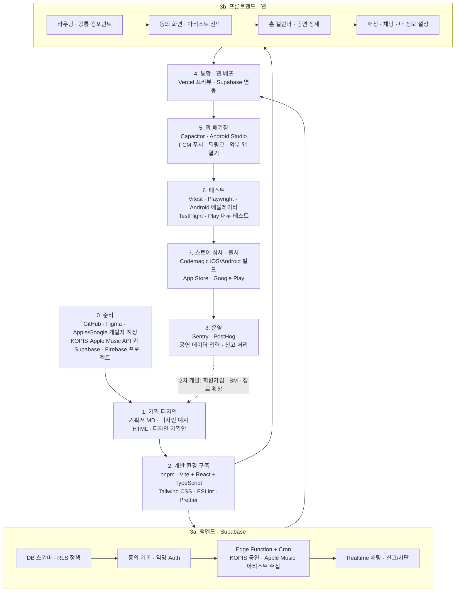
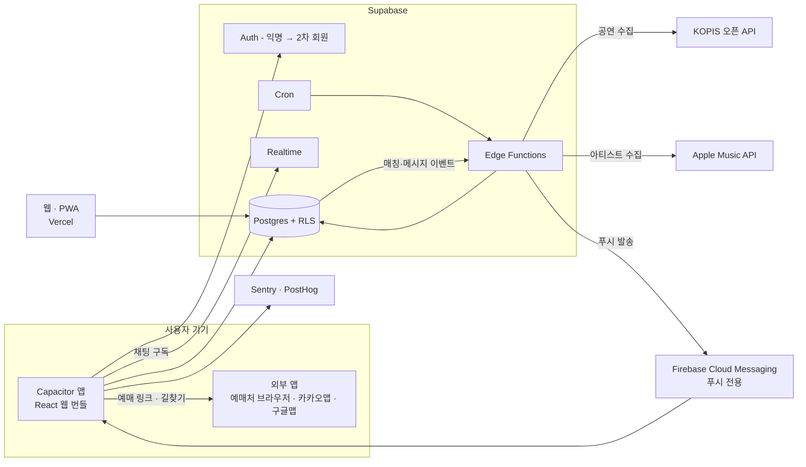
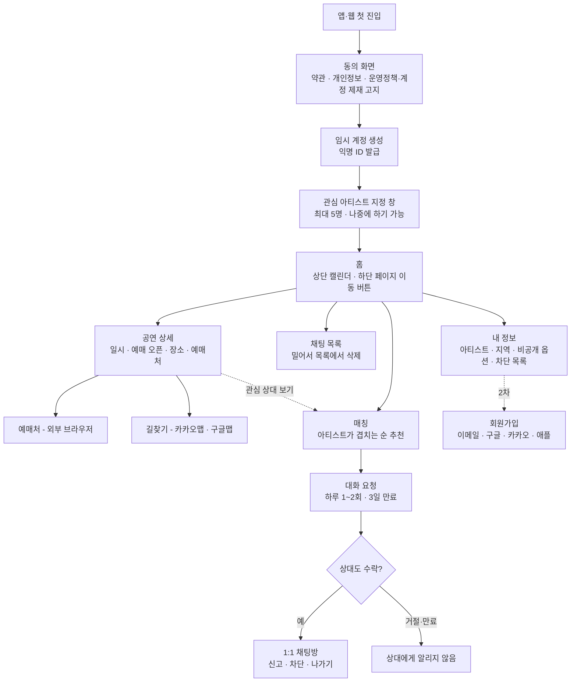

# 덕친소 기획서 (J-pop 공연 캘린더·취향 매칭 앱)

작성일: 2026-10-05 · 수정일: 2026-10-30 (개발 전 확정 사항 반영, 동의 화면·회원가입·BM·법률 대응 추가)

## 1. 개요

덕친소는 흩어진 J-pop 공연 일정을 한 캘린더에 모으고, 좋아하는 아티스트가 겹치는 사람끼리 상호 수락으로 연결해 "같이 갈 사람"을 찾게 해 주는 앱이다. 웹으로 먼저 만들고 Capacitor로 Android·iOS에 동시 배포한다. 서비스명은 "덕친소"로 1차 지정했고 개발 중 변경할 수 있다. 초기 버전은 **J-pop 한 장르, 비회원(임시 계정)**으로 시작하고 회원가입·BM·장르 확장은 2차에서 한다.

**해결하려는 문제**

- J-pop 내한 공연 정보가 NOL티켓, 멜론티켓, 예스24티켓, 티켓링크, 각 기획사 SNS에 흩어져 있어 놓치기 쉽다.
- J-pop은 국내에서 취향층이 좁아 주변에 같이 공연 갈 사람이 없다.
- 기존 커뮤니티(오픈채팅, 카페)는 취향 단위 매칭이나 안전장치가 약하다.

**타깃 사용자**

- 1차: 20\~30대 J-pop 팬, 내한 공연을 보거나 보고 싶은 사람
- 2차: 혼공(혼자 공연) 경험이 있고 동행·친구를 찾는 사용자

**핵심 가치**

| 가치 | 사용자가 얻는 것 |
| --- | --- |
| 모아보기 | 여러 예매처의 J-pop 공연을 캘린더 하나로 확인 |
| 바로가기 | 공연 선택 → 예매처·지도 앱으로 바로 이동 |
| 연결 | 좋아하는 아티스트가 겹치는 사람과 상호 수락 후 대화, 동행·친목 |

## 2. 개발·배포 방식

반응형 웹앱(SPA)을 만든 뒤 Capacitor로 감싸 Android(Google Play)와 iOS(App Store)에 배포한다. 코드 하나로 웹·Android·iOS 3개 채널을 운영하고, 푸시 알림·딥링크 등 네이티브 기능은 플러그인으로 보강한다. 세부 툴과 충돌 방지 규칙은 3장에 정리했다.

**패키징 방식 비교**

| 방식 | 장점 | 단점 | 판단 |
| --- | --- | --- | --- |
| Capacitor (권장) | 웹 코드 그대로 사용, 네이티브 플러그인(푸시, 공유, 외부 앱 열기) 풍부 | 복잡한 애니메이션은 네이티브보다 느림 | 채택 |
| 웹뷰 래퍼 직접 구현 | 구조 단순 | 네이티브 브리지를 직접 작성해야 함 | 유지보수 부담 |
| PWA만 운영 | 스토어 심사 없음 | iOS 설치·푸시 제약, 스토어 노출 없음 | 보조 채널로 병행 |
| React Native / Flutter | 네이티브에 가까운 성능 | 웹 코드 재사용 불가 | 현 방향과 맞지 않음 |

**지원 OS (2026-10-30 결정)**

| 플랫폼 | 최소 버전 | 타깃 | 비고 |
| --- | --- | --- | --- |
| Android | Android 8.0 (minSdk 26) | API 36 (targetSdk·compileSdk) | Capacitor 지원 범위 안 |
| iOS | iOS 16 | 최신 SDK | Capacitor 지원 범위 안 |

> Android는 최소 버전을 8.0(API 26)으로 낮추고 타깃 API 36은 유지한다. Google Play는 타깃 API 수준만 최신 기준을 요구하므로, 매년 타깃만 올리면 된다. Android 8.0 미만에서만 쓰는 우회 코드는 작성하지 않는다.

**스토어 심사 유의사항**

- Apple 가이드라인 4.2(최소 기능): 웹사이트를 감싼 것에 그치면 리젝될 수 있어 푸시 알림, 캘린더 저장, 외부 지도·예매 앱 연동 등 앱다운 기능을 MVP에 넣는다.
- 가이드라인 1.2(사용자 생성 콘텐츠): 채팅이 있으므로 신고·차단·부적절 콘텐츠 필터링·운영자 연락처가 필수다.
- 가이드라인 4.8(로그인 서비스): 구글·카카오 등 외부 소셜 로그인을 넣으면 iOS에는 Sign in with Apple 같은 동등한 프라이버시 로그인을 함께 제공해야 한다.
- 가이드라인 5.1.1(v) 및 Google Play 정책: 앱에서 계정을 만들 수 있으면 **앱 안에서 계정 삭제**도 할 수 있어야 한다(2차 회원가입 시 필수).
- 디지털 상품(구독 등) 판매 시 인앱결제 정책이 적용된다(11장 BM 참고).

## 3. 전체 개발 흐름과 툴 체계

모든 툴은 "Vite로 만든 정적 SPA + Supabase 하나의 백엔드 + Capacitor 하나의 패키징" 축에 맞춰 골랐다. 이 축에서 벗어나는 선택(SSR 프레임워크, 인증 시스템 이중화, UI 라이브러리 혼용)이 대부분의 충돌 원인이므로 3.4의 규칙으로 막는다. 설치 방법과 GitHub 운영 규칙은 [개발환경_및_GitHub_운영가이드.md](개발환경_및_GitHub_운영가이드.md)에 따로 정리했다.

### 3.1 개발 과정 흐름도

3a 백엔드와 3b 프론트엔드는 병행 개발하고, 4단계에서 합친 뒤 같은 웹 빌드를 Capacitor로 앱에 넣는다. 웹 배포와 앱 빌드는 같은 `dist` 결과물을 쓰므로 코드가 갈라지지 않는다.

### 3.2 시스템 구성도 (툴이 서로 연결되는 방식)

인증·데이터·실시간·서버 로직은 모두 Supabase가 맡고, Firebase는 푸시(FCM) 한 가지에만 쓴다. 예매와 길찾기는 외부 앱으로 넘기므로 결제·위치 정보가 우리 시스템에 들어오지 않는다.

### 3.3 영역별 추천 툴 (추천도 순)

★ 표시가 채택안이며, 2·3순위는 채택안에 문제가 생겼을 때의 대안이다.

**① 프론트엔드 프레임워크**

| 순위 | 툴 | 장점 | 단점 |
| --- | --- | --- | --- |
| 1 ★ | React + Vite + TypeScript | 생태계·자료 최대, FullCalendar·Supabase·Capacitor 공식 예제 풍부, Vite 정적 빌드가 Capacitor와 바로 맞음 | 상태관리·라우팅 등을 직접 골라 조합해야 함 |
| 2 | Vue 3 + Vite | 학습 곡선 낮음, 공식 라우터·상태관리(Pinia) 제공 | 국내 채용·레퍼런스가 React보다 적음 |
| 3 | SvelteKit (static adapter) | 번들 작고 빠름 | 정적 모드 설정 필요, 라이브러리 선택지 적음 |

**② UI·스타일**

| 순위 | 툴 | 장점 | 단점 |
| --- | --- | --- | --- |
| 1 ★ | Tailwind CSS + shadcn/ui | 디자인 자유도 높음, 컴포넌트 코드를 프로젝트에 복사해 의존성 충돌 적음, 13장의 분리형 컴포넌트 구조와 잘 맞음 | 모바일 네이티브 느낌(전환 애니메이션 등)은 직접 구현 |
| 2 | Ionic React | Capacitor 제작사 UI, iOS/Android 네이티브 느낌 컴포넌트 기본 제공 | 자체 라우터가 React Router 특정 버전에 묶여 있음(도입 시 버전 확인 필요), Tailwind와 혼용 시 스타일 충돌 |
| 3 | MUI | 컴포넌트 수 많음, 문서 충실 | 머티리얼 디자인 느낌이 강해 iOS에서 이질감, 번들 큼 |

**③ 캘린더**

| 순위 | 툴 | 장점 | 단점 |
| --- | --- | --- | --- |
| 1 ★ | FullCalendar (React) | 월/주/리스트 뷰 기본 제공, 이벤트 데이터 연동 쉬움 | 일부 고급 플러그인은 유료(본 서비스엔 불필요), 모바일 스타일 손질 필요 |
| 2 | react-big-calendar | 무료, 가벼움 | 모바일 대응·커스터마이즈 손이 더 감 |
| 3 | 직접 구현 (date-fns) | 디자인 완전 통제 | 개발 공수 큼 |

**④ 상태·서버 데이터 관리**

| 순위 | 툴 | 장점 | 단점 |
| --- | --- | --- | --- |
| 1 ★ | TanStack Query + Zustand | 서버 데이터 캐싱(Query)과 앱 상태(Zustand) 역할 분리 명확, 가벼움 | 두 개념을 구분해 써야 함 |
| 2 | Redux Toolkit (+ RTK Query) | 하나로 통합, 대규모에 강함 | 보일러플레이트 많음, 초기 단계에 과함 |
| 3 | SWR + React Context | 매우 단순 | 앱 상태가 늘면 관리 어려움 |

**⑤ 백엔드 (BaaS)**

| 순위 | 툴 | 장점 | 단점 |
| --- | --- | --- | --- |
| 1 ★ | Supabase | Postgres(관계형)라 공연·매칭 데이터에 적합, 익명 로그인 → 회원 계정 연결 지원, 이메일·구글·카카오·애플 로그인 기본 제공, Realtime·Edge Functions·Cron 한 곳에서 | 푸시 기능 없음(FCM 별도), 무료 플랜은 비활성 시 일시정지 |
| 2 | Firebase | 푸시·분석·인증 올인원, 모바일 레퍼런스 풍부 | NoSQL이라 매칭·필터 쿼리 설계가 까다로움, 카카오 로그인은 직접 구현(커스텀 토큰) 필요 |
| 3 | 자체 서버 (NestJS + Postgres) | 완전한 통제 | 인증·실시간·배포를 모두 직접 구축, 초기 공수 큼 |

**⑥ 푸시 알림**

| 순위 | 툴 | 장점 | 단점 |
| --- | --- | --- | --- |
| 1 ★ | FCM + @capacitor-firebase/messaging | Android·iOS 모두 FCM 토큰 하나로 통일, 무료 | iOS용 APNs 키를 Firebase에 등록해야 함 |
| 2 | FCM + @capacitor/push-notifications | Capacitor 공식 플러그인 | iOS에서는 APNs 토큰이 나와 서버가 플랫폼별로 분기해야 함 |
| 3 | OneSignal | 대시보드·세그먼트 발송 편리 | 외부 서비스 의존 추가, 사용자 데이터가 제3자에 저장 |

**⑦ 공연 데이터 수집 스케줄러**

| 순위 | 툴 | 장점 | 단점 |
| --- | --- | --- | --- |
| 1 ★ | Supabase Edge Functions + Cron | 백엔드와 같은 곳에서 실행, DB 직접 저장, 별도 서버 불필요 | KOPIS 응답(XML) 파싱 코드 직접 작성 |
| 2 | GitHub Actions 예약 실행 | 설정 간단, 로그 확인 쉬움 | DB 접속 비밀키를 GitHub에 보관해야 함 |
| 3 | 수동 입력만 | 구현 불필요 | 운영 인력 소모 |

**⑧ 아티스트 목록 수집 (2026-10-30 추가)**

| 순위 | 툴 | 장점 | 단점 |
| --- | --- | --- | --- |
| 1 ★ | Apple Music API | J-Pop 장르 분류와 장르별 차트 제공, 아티스트 이미지·다국어 이름, iOS 배포용 Apple 개발자 계정으로 키 발급 가능 | "J-Pop 아티스트 전체 목록" 조회 기능은 없어 장르 차트·검색 결과에서 아티스트를 모아야 함. 수집 데이터의 저장·표시 조건은 이용약관 확인 필요 |
| 2 | Spotify Web API | 아티스트마다 장르 태그 제공, 검색 쉬움 | 신규 앱에 일부 기능 제한이 생기는 추세, 저장·표시 조건 확인 필요 |
| 3 | 운영자 수동 입력 | 약관 문제 없음, 품질 통제 | 인력 소요 |

결정: Apple Music API로 수집하고, 키 발급이나 약관상 불가능하면 **아티스트 목록을 비워 두고 보류**한다(5.1 참고).

**⑨ 외부 앱 연동 (예매·길찾기)**

| 순위 | 툴 | 장점 | 단점 |
| --- | --- | --- | --- |
| 1 ★ | @capacitor/app-launcher + 지도 앱 웹 링크 | 예매처는 외부 브라우저로, 길찾기는 카카오맵·구글맵 링크로 열어 앱이 깔려 있으면 앱으로 이동 | 설치된 앱 확인을 하려면 iOS에 URL 스킴 등록 필요 |
| 2 | @capacitor/browser (인앱 브라우저) | 앱을 떠나지 않음 | 결정(외부 브라우저 이동)과 다름, 예매처 로그인 상태 공유 안 됨 |

**⑩ iOS 빌드·배포 (Windows 개발 환경 기준)**

iOS 앱 빌드에는 macOS + Xcode가 반드시 필요하다. 현재 개발 PC가 Windows이므로 아래 중 하나가 필요하다.

| 순위 | 툴 | 장점 | 단점 |
| --- | --- | --- | --- |
| 1 ★ | Codemagic (클라우드 CI) | Mac 없이 iOS·Android 빌드와 스토어 업로드 자동화, Capacitor 지원 | 무료 빌드 시간 한도, 서명 인증서 설정 학습 필요 |
| 2 | GitHub Actions macOS 러너 + fastlane | 코드 저장소와 한곳에서 관리 | macOS 러너 비용, 설정 난이도 높음 |
| 3 | Mac 직접 구매 (Mac mini 등) | Xcode로 직접 디버깅 가능, 시뮬레이터 사용 | 초기 비용 |

**⑪ 웹 호스팅**

| 순위 | 툴 | 장점 | 단점 |
| --- | --- | --- | --- |
| 1 ★ | Vercel | Git 푸시만으로 배포, PR별 프리뷰 URL, 딥링크용 `.well-known` 파일 배포 쉬움 | 무료 플랜 상업 이용 제한(유료 전환 필요 시점 확인) |
| 2 | Cloudflare Pages | 무료 한도 넉넉, 빠른 CDN | 설정 화면이 다소 복잡 |
| 3 | Netlify | Vercel과 비슷한 편의성 | 무료 한도 초과 시 비용 |

**⑫ 모니터링·분석**

| 순위 | 툴 | 장점 | 단점 |
| --- | --- | --- | --- |
| 1 ★ | Sentry + PostHog | 오류 추적(Capacitor SDK 제공) + 제품 분석(퍼널·리텐션)을 각각 전문 툴로 | 툴 두 개 관리 |
| 2 | Sentry + Firebase Analytics | 이미 FCM용 Firebase가 있어 추가 설정 적음 | 분석 화면이 퍼널 분석에 덜 직관적 |

**⑬ 관리자 도구 (공연 등록·신고 처리)**

| 순위 | 툴 | 장점 | 단점 |
| --- | --- | --- | --- |
| 1 ★ | Supabase Studio(초기) → 앱 내 관리자 페이지 | 추가 툴 없음, 같은 코드베이스 | 관리자 페이지 개발 공수 |
| 2 | Retool / Appsmith | 드래그로 관리 화면 빠르게 제작 | 외부 툴 비용·권한 관리 |

**⑭ 인앱결제 (2차 BM)**

| 순위 | 툴 | 장점 | 단점 |
| --- | --- | --- | --- |
| 1 ★ | RevenueCat (Capacitor 플러그인) | Apple·Google 구독을 한 API로 관리, 구독 상태를 서버에서 확인 | 매출 일정 규모 이상부터 수수료 |
| 2 | 스토어 결제 SDK 직접 연동 | 외부 수수료 없음 | 플랫폼별 영수증 검증·구독 갱신 처리를 직접 구현 |

**공통 툴 (단일 선택)**: GitHub(코드·이슈), Figma(디자인), pnpm(패키지 매니저), ESLint + Prettier(코드 규칙), Vitest + Playwright(테스트), Android Studio(Android 빌드·에뮬레이터).

### 3.4 충돌 방지 규칙

각 행은 실제로 자주 생기는 충돌과 그것을 막는 규칙이다. 새 툴을 추가할 때 이 표에 먼저 대조한다.

| 충돌 지점 | 문제 | 규칙 |
| --- | --- | --- |
| SSR 프레임워크 vs Capacitor | Next.js 등 서버 렌더링 기능은 앱 안(정적 파일)에서 동작하지 않음 | Vite 정적 SPA만 사용, 서버 로직은 Supabase Edge Functions로 |
| 인증 시스템 이중화 | Supabase Auth와 Firebase Auth를 같이 쓰면 사용자 ID가 둘로 갈라짐 | 인증은 Supabase만. Firebase는 FCM(푸시) 전용으로 Auth 미설치 |
| 익명 → 회원 전환 | 회원가입 시 새 계정을 만들면 임시 계정의 아티스트·채팅 기록이 끊김 | 기존 익명 계정에 이메일·소셜 계정을 **연결**하는 방식만 사용 |
| 푸시 플러그인 중복 | 두 푸시 플러그인을 함께 설치하면 토큰·알림 수신이 서로 간섭 | @capacitor-firebase/messaging 하나만 설치 |
| UI 라이브러리 혼용 | Tailwind와 Ionic/MUI를 섞으면 리셋 CSS·테마가 충돌 | 스타일은 Tailwind + shadcn/ui 하나로 통일 |
| 외부 링크 방식 혼용 | 화면마다 인앱 브라우저·외부 브라우저가 섞이면 사용자 경험과 로그인 상태가 어긋남 | 예매·길찾기는 모두 외부 앱 열기(app-launcher)로 통일 |
| 소셜 로그인과 웹뷰 (2차) | 구글은 앱 내 웹뷰에서의 OAuth 로그인을 차단 | 로그인은 시스템 브라우저 또는 네이티브 로그인 플러그인으로 열고, 딥링크로 앱 복귀 |
| 딥링크 도메인 | Universal Links / App Links는 웹 도메인 검증 파일이 필요 | Vercel 도메인의 `/.well-known/`에 `apple-app-site-association`, `assetlinks.json` 배포 |
| Capacitor 플러그인 버전 | 플러그인 메이저 버전이 Capacitor 코어와 다르면 빌드 실패 | 코어·플러그인 메이저 버전 일치, 업그레이드는 한 번에 |
| 패키지 매니저 혼용 | npm·yarn·pnpm 잠금 파일이 섞이면 의존성 버전이 어긋남 | pnpm만 사용, `pnpm-lock.yaml`만 커밋 |
| 시간대 | 서버(UTC)와 기기(KST) 시간이 섞여 공연 날짜가 하루 밀림 | DB는 `timestamptz`(UTC) 저장, 화면은 Asia/Seoul로 변환 |
| 비밀키 노출 | 서비스 키가 앱 번들에 들어가면 누구나 DB 전체 접근 | 앱에는 anon 키만, 모든 테이블 RLS 필수, service role·Apple Music 키는 Edge Functions에서만 |
| 상태 관리 중복 | 서버 데이터를 Query와 Zustand 양쪽에 저장하면 값이 어긋남 | 서버 데이터는 TanStack Query, 화면 상태(필터·모달)만 Zustand |
| 결제 시스템 혼용 (2차) | 플랫폼마다 결제 처리를 따로 만들면 구독 상태가 어긋남 | 구독 상태의 기준은 RevenueCat 한 곳, 앱은 그 값만 읽음 |
| 설정값 하드코딩 | 요청 한도·만료 기간을 코드에 박으면 바꿀 때마다 앱 재배포 | 운영 설정값은 DB `app_settings` 테이블에서 읽음(12장) |
| iOS 빌드 환경 | Windows에서는 iOS 빌드 불가 | iOS 빌드·업로드는 Codemagic으로 고정 |

### 3.5 채택 스택 요약

| 영역 | 채택 |
| --- | --- |
| 프론트엔드 | React + Vite + TypeScript, React Router |
| UI | Tailwind CSS + shadcn/ui (13장 컴포넌트 구조) |
| 캘린더 | FullCalendar |
| 상태·데이터 | TanStack Query + Zustand |
| 백엔드 | Supabase (Postgres, 익명·회원 Auth, Realtime, Edge Functions, Cron) |
| 외부 데이터 | KOPIS(공연), Apple Music API(아티스트) |
| 푸시 | FCM + @capacitor-firebase/messaging |
| 앱 패키징 | Capacitor (App, App Launcher, Share 플러그인) |
| 빌드·배포 | Android Studio(로컬), Codemagic(iOS·스토어 배포), Vercel(웹) |
| 모니터링 | Sentry + PostHog |
| 결제 (2차) | RevenueCat |
| 협업 | GitHub, Figma, pnpm |

## 4. 기능 범위와 단계별 로드맵

MVP는 "동의 후 임시 계정으로 들어와 좋아하는 J-pop 아티스트를 고르고, 홈 캘린더에서 공연을 보고, 예매처·지도 앱으로 이동하고, 매칭된 사람과 대화한다"까지를 담는다.

| 기능 | MVP (1차) | 2차 | 3차 |
| --- | --- | --- | --- |
| 동의·계정 | 첫 진입 동의 화면 + 임시(익명) 계정 | 자체 회원가입·소셜 연동, 계정 삭제, 비밀번호 찾기 | 본인인증 옵션 |
| 취향 선택 | J-pop 고정, 관심 아티스트 최대 5명(설정값 3\~5) | 장르 선택 개방(락, 국내 인디, 힙합 등) | 청취 이력 연동 검토 |
| 공연 캘린더 | 홈 상단 캘린더, 아티스트·지역 필터, 상세(일시·예매 오픈·장소·예매처) | 관심 공연 찜, 예매 오픈 알림 | 개인 캘린더 내보내기 자동화 |
| 외부 연동 | 예매처 외부 브라우저, 길찾기 지도 앱 | 예매처별 딥링크, 클릭 추적 | 제휴 수수료 |
| 취향 매칭 | 아티스트 유사도 추천, 하루 요청 1\~2회, 3일 만료, 상호 수락, 1:1 채팅 | 공연별 동행 모집, 그룹 채팅 | 오프라인 모임·후기 |
| 안전 | 신고·차단(상대 미통지), 필터, 제재 단계 | 매너 점수, 자동 제재 | 본인인증 연계 |
| 개인정보 | 지역 시·도만, 내 정보 비공개 옵션 | 공개 범위 세분화 | — |
| BM | 없음(지표 수집만) | 회원 대상 멤버십·광고 테스트 | 본격 수익화(arena로 결정) |

## 5. 기능 상세 명세

### 5.1 첫 진입: 동의 화면 → 임시 계정 → 관심 아티스트 지정

앱·웹 첫 진입 시 **동의 화면을 가장 먼저** 보여 주고(9장), 동의가 끝나면 임시(익명) 계정을 만든 뒤 관심 아티스트 지정 창을 띄운다.

**관심 아티스트 지정 창**

- 최대 5명까지 선택(상한은 운영 설정값으로 3\~5 사이에서 조정), 최소 0명
- "나중에 하기"로 건너뛸 수 있고, 지정 창을 벗어난 뒤에도 내 정보·캘린더 화면에서 언제든 지정·수정
- 아티스트가 0명이면 캘린더는 전체 J-pop 공연을 보여 주고, 매칭 탭에는 "아티스트를 지정하면 추천이 시작돼요" 안내를 표시
- 아티스트 목록 출처: Apple Music API로 수집(3.3 ⑧). **수집이 불가능하면 목록을 비워 두고 이 창은 검색 없이 "준비 중" 상태로 보류**하며, 캘린더·매칭은 위 0명 규칙으로 동작
- 장르 구조(genres 테이블)는 DB에 미리 만들어 두고 화면에는 노출하지 않음 → 2차 장르 확장 시 UI만 추가

### 5.2 홈 화면: 캘린더 + 페이지 이동

모바일 앱 기준 첫 화면(동의·임시 계정·아티스트 지정을 마친 뒤)은 **상단에 캘린더, 하단에 각 페이지 이동 버튼**을 둔다. 배치는 [덕친소_운영방안.html](덕친소_운영방안.html)의 앱 디자인 예시를 따른다.

- 상단: 월간 캘린더(날짜별 공연 표시), 필터(내 아티스트 / 전체, 지역, 예매 상태), 선택한 날짜의 공연 목록
- 하단 이동 버튼: 캘린더(홈) · 매칭 · 채팅 · 내 정보
- 기본 표시: 내 아티스트 공연 우선, 아티스트 미지정 시 전체 J-pop

**공연 상세: 앱 안에서는 4가지만 표시**

| 앱 안 표시 | 외부로 넘김 |
| --- | --- |
| 공연 일시 | 길찾기 → 카카오맵·구글맵 등 지도 앱(앱이 없으면 지도 웹페이지) |
| 예매 오픈 일시 | 예매 링크 → 각 예매처를 외부 브라우저로 열기 |
| 공연 장소(이름) | — |
| 예매처(이름 버튼) | — |

가격·좌석·관람 정보 등 나머지는 예매처 페이지에서 확인하게 한다. 공연 포스터와 아티스트명은 식별용으로 함께 보여 준다. 부가 기능으로 내 기기 캘린더 저장, 공연 공유, 이 공연에 관심 있는 매칭 상대 수 표시를 둔다.

### 5.3 취향 매칭 (상호 수락)

양쪽이 모두 수락해야만 채팅방이 열린다. 한쪽만 요청한 상태에서는 메시지를 보낼 수 없다.

1. 추천: 아티스트 겹침 점수가 높은 사용자를 카드로 노출(닉네임, 겹치는 아티스트, 한줄 소개, 관심 공연, 공개한 경우 지역)
2. 요청: "대화 요청" 또는 "넘기기". 요청에 선택적으로 인사말(50자) 첨부
3. 수락: 상대가 받은 요청함에서 수락/거절. 거절은 상대에게 알리지 않음
4. 매칭 성립: 양쪽 수락 시 1:1 채팅방 생성 + 푸시 알림

**매칭 규칙 (2026-10-30 결정)**

| 규칙 | 값 | 비고 |
| --- | --- | --- |
| 요청 만료 | 최대 3일 | 기간 내 응답이 없으면 자동 만료, 요청자에게는 "응답 없음"으로만 표시 |
| 요청 한도 | 하루 1\~2회 | 운영 설정값(기본 2회), 한국 시간 자정 기준 초기화 |
| 거절·만료 상대 | 일정 기간 재추천 제외 | 기간은 운영 설정값 |
| 매칭 점수 | 아티스트 자카드 유사도 + 가산점 | 겹치는 아티스트 수 ÷ 합집합 아티스트 수, 같은 공연 관심·최근 접속 가산 |

### 5.4 채팅·차단

- 대화: 텍스트·이모지 중심(MVP에서는 사진 전송 제외 권장), 공연 카드 공유
- **차단**: 차단한 사람만 해제할 수 있다. 차단과 해제 모두 **상대에게 알리지 않는다**. 차단 중에는 서로 추천·요청·메시지가 불가하고, 상대 화면에서는 일반 "대화 불가" 상태와 구분되지 않게 처리
- **상대가 나간 채팅방**: 남은 사람이 채팅방에 들어오면 "상대방이 대화방을 나갔습니다" 문구를 대화 끝에 표시하고 입력창을 비활성화
- **채팅 목록에서 숨기기**: 목록에서 밀기(스와이프) 또는 길게 누르기 → "목록에서 삭제". 내 목록에서만 사라지고 상대 화면과 신고용 기록에는 영향 없음
- 신고: 대화 메뉴에서 언제든 가능(8장)

### 5.5 내 정보·공개 설정

- 프로필: 닉네임, 한줄 소개, 관심 아티스트
- 지역: **시·도까지만** 선택(상세 주소는 받지 않음)
- **내 정보 비공개 옵션**: 지역(그리고 추후 추가될 공개 항목)을 매칭 카드에 아예 표시하지 않도록 설정. 비공개로 두면 지역 가산점은 적용하지 않음
- 차단 목록(해제 가능), 알림 설정, 약관·개인정보 처리방침·동의 내역 확인

## 6. 화면 구성(IA)과 사용자 흐름

| 하단 버튼 | 주요 화면 |
| --- | --- |
| 캘린더(홈) | 월간 캘린더, 날짜별 공연 목록, 필터, 공연 상세 |
| 매칭 | 추천 카드, 받은 요청함, 보낸 요청(남은 시간 표시) |
| 채팅 | 채팅 목록(숨기기), 채팅방(신고·차단·나가기) |
| 내 정보 | 프로필·아티스트·지역, 비공개 옵션, 차단 목록, 알림, 약관·동의 내역, (2차) 회원가입·로그인 |

## 7. 데이터 수급·외부 연동 전략

공연 데이터는 **운영자 입력을 중심으로 하고 KOPIS 수집으로 보완**하며, 아티스트 목록은 Apple Music API로 모은다. 예매처 제휴는 2차에 추진한다.

| 수급 방식 | 내용 | 장점 | 주의점 | 단계 |
| --- | --- | --- | --- | --- |
| 운영자 입력 | 관리자 화면에서 J-pop 공연·예매처·예매 링크 등록 | 품질 통제, J-pop 판별 정확 | 인력 소요(공연 수가 적어 초기엔 감당 가능) | MVP 주력 |
| 공공 데이터 | KOPIS 오픈 API에서 대중음악 공연 수집 후 J-pop 아티스트 목록과 대조 | 합법·무료, 누락 방지용 보조 | 장르가 대분류라 자동 판별 한계 | MVP 보조 |
| Apple Music API | J-Pop 장르 차트·검색으로 아티스트 이름·이미지 수집 | 공식 데이터, 다국어 이름 | 약관상 저장·표시 조건 확인 필요, 불가 시 보류 | MVP |
| 사용자 제보 | 공연 정보·링크 제보, 운영자 검수 후 노출 | 커버리지 확대 | 검수 필요 | 2차 |
| 예매처 제휴 | NOL티켓, 멜론티켓, YES24티켓, 티켓링크 등과 데이터·제휴링크 계약 | 정확한 데이터, 수수료 BM | 트래픽 입증 후 협상 가능 | 2\~3차 |
| 크롤링 | 예매처 웹페이지 자동 수집 | 커버리지 넓음 | 이용약관 위반·법적 분쟁 소지 | 원칙적 미사용 |

**공연 게시 필수값**: 공연 일시, 예매 오픈 일시, 공연 장소(이름 + 지도 검색어), 예매처(이름 + 링크 1개 이상). 하나라도 없으면 게시 불가.

**외부 이동 방식**

- 예매: 예매처 링크를 외부 브라우저로 연다(App Launcher). 결제는 전적으로 예매처에서 진행
- 길찾기: 장소명·주소로 카카오맵·구글맵 링크를 연다. 앱이 설치돼 있으면 지도 앱, 없으면 지도 웹페이지. 사용자가 고를 지도 앱 목록은 설정값으로 관리
- 예매처 로고·상표 사용은 제휴 전까지 텍스트 표기로 대체

참고: KOPIS·Apple Music API의 제공 항목·이용 조건과 각 예매처 제휴 프로그램 유무는 개발 착수 전 직접 확인이 필요하다(본 문서는 미확인 상태).

## 8. 임시 계정과 커뮤니티 안전

MVP는 회원가입 없이 Supabase 익명 Auth로 임시 계정을 만든다. **임시 계정은 복구 기능을 두지 않는다**(앱 삭제·기기 변경 시 새 계정). 계정 복구는 2차 회원가입의 비밀번호 찾기로 제공한다(10장).

**채팅 안전장치 (MVP 필수)**

- [ ] 첫 진입 동의 화면에서 운영정책·계정 제재 고지 동의(9장)
- [ ] 사용자 신고(사유 선택: 욕설, 성희롱, 사기·암표, 스팸, 기타)
- [ ] 차단·해제(상대 미통지, 5.4)
- [ ] 금칙어·연락처·외부 링크 필터 및 경고
- [ ] 운영자 제재 도구(신고 큐, 경고·정지)
- [ ] 연애·만남 목적 운영 금지 안내, 첫 만남은 공연장 등 공개 장소 권장 문구

**악용 대응**: 제재된 사용자가 앱 재설치로 우회하지 않도록 기기 식별값·패턴 기반 보조 제재를 검토하고, 그 사실을 개인정보 처리방침에 명시한다.

## 9. 법률 대응과 동의 화면 (2026-10-30 추가)

앱·웹에 처음 들어오면 **임시 계정을 만들기 전에** 동의 화면을 띄우고, 필수 항목에 동의해야 서비스를 쓸 수 있다. 동의 화면에는 관련 법률과 운영정책에 따라 **계정이 정지될 수 있다는 사실을 명확히 고지**한다. 아래 법률 정리는 기획 단계의 검토 목록이며, 약관·처리방침 확정 전 법률 전문가 검토를 받는다.

### 9.1 적용 법률과 대응

| 법률 | 관련 기능 | 해야 할 일 |
| --- | --- | --- |
| 개인정보 보호법 | 임시 계정 ID, 닉네임, 지역, 관심 아티스트, 채팅, 푸시 토큰, (2차) 이메일·소셜 계정 정보 | 필수·선택 항목을 나눠 동의, 개인정보 처리방침 공개, 만 14세 미만 이용 제한(또는 법정대리인 동의), 보관 기간과 파기 기준 명시 |
| 정보통신망법 | 채팅, 광고성 푸시 | 불법정보 유통 금지 조치, 권리 침해 게시물 처리 절차, 광고성 정보 수신 별도 동의(야간 발송은 추가 동의) |
| 전기통신사업법 | 사용자 간 채팅(부가통신 서비스), (2차) 인앱결제 | 부가통신사업 신고 대상 여부 확인(소규모 사업자 예외 확인), 결제 관련 조항 확인 |
| 통신비밀보호법 | 채팅 내용 | 운영자는 대화를 임의로 열람하지 않고, 신고 시 신고자가 제출한 대화에 한해 확인한다는 원칙을 약관·처리방침에 명시 |
| 공연법 | 티켓 부정판매(매크로 이용 암표 등) | 앱 안에서 티켓 양도·재판매 권유 금지, 위반 시 제재 |
| 형법(사기), 경범죄 처벌법 | 암표 거래, 금전 사기 | 대화 중 금전·티켓 거래 유도 감지 시 경고, 사기 의심 시 영구 정지와 수사기관 신고 안내 |
| 청소년 보호법 | 낯선 사람과의 채팅 | 연령 확인, 유해 내용 차단 |
| 전자상거래법 (2차) | 유료 멤버십 | 청약철회 안내, 사업자 정보 표시, 통신판매업 신고 |
| 위치정보법 | 해당 없음 | GPS를 수집하지 않고 시·도 선택만 유지 |

### 9.2 동의 화면 구성

| 구분 | 항목 | 비고 |
| --- | --- | --- |
| 필수 | 만 14세 이상입니다 | 미체크 시 진행 불가 |
| 필수 | 서비스 이용약관 | 전문 보기 링크 |
| 필수 | 개인정보 수집·이용 | 항목·목적·보관 기간 표로 표시 |
| 필수 | 커뮤니티 운영정책 및 계정 제재 고지 | 9.3 제재 기준 요약을 화면에 직접 노출 |
| 선택 | 서비스 알림(새 공연, 매칭 요청) | 기기 알림 권한과 별개 |
| 선택 | 광고성 정보 수신(이벤트·혜택) | 2차 BM 시작 시 사용 |
| 선택 | 야간(21시\~08시) 광고성 정보 수신 | 광고성 수신 동의자에 한해 |

- "전체 동의" 버튼 + 항목별 체크, 항목별 전문 펼쳐보기
- 동의한 약관 버전과 시각을 `consents` 테이블에 기록, 약관이 바뀌면 다음 실행 때 변경 항목만 재동의
- 2차 회원가입 시: 임시 계정에서 이미 동의한 항목은 다시 묻지 않고, 회원가입으로 새로 수집하는 항목(이메일 등)만 추가 동의
- 내 정보 화면에서 동의 내역 확인, 선택 항목은 언제든 철회

### 9.3 계정 제재 기준 (초안)

| 위반 유형 | 예 | 조치 |
| --- | --- | --- |
| 경미 | 욕설, 불쾌한 표현, 스팸성 요청 | 1회 경고 → 반복 시 일시 정지 |
| 중대 | 성희롱, 지속적 괴롭힘, 개인정보 무단 공개 | 일시 정지 또는 영구 정지 |
| 법률 위반 | 사기, 암표·매크로 티켓 거래, 불법촬영물 등 | 즉시 영구 정지, 수사기관 신고 안내, 법령에 따른 자료 보관 |

일시 정지 기간, 경고 누적 기준은 베타 운영 후 확정한다. 제재 사실과 사유는 해당 사용자에게 알리고 이의 제기 경로를 둔다(차단과 달리 운영자 제재는 본인에게 통지).

## 10. 회원가입 기능 (2차)

임시 계정 사용자는 언제든 회원으로 전환할 수 있고, **전환해도 같은 계정을 유지**해 관심 아티스트·매칭·채팅 기록이 이어진다. 기본 기능(캘린더·매칭)은 비회원도 계속 쓸 수 있게 하고, 회원 전용 기능과 BM(11장)에서 가입을 유도한다.

**가입 방식**

| 방식 | 구현 | 비고 |
| --- | --- | --- |
| 자체 회원가입 (이메일 + 비밀번호) | Supabase 이메일 인증 | 이메일 인증 필수, 비밀번호 찾기(재설정 메일 → 딥링크로 앱 재설정 화면) |
| 구글 | Supabase 기본 제공 | 시스템 브라우저 또는 네이티브 로그인으로 진행(웹뷰 차단, 3.4) |
| 카카오 | Supabase 기본 제공 | 이메일 제공 동의 항목은 카카오 비즈 앱 전환이 필요할 수 있음(확인 필요) |
| 애플 | Supabase 기본 제공 | iOS에서 소셜 로그인을 제공하면 함께 제공해야 함(2장) |
| 네이버 | 기본 제공 아님 | 수요 확인 후 별도 구현 검토 |

**전환·관리 규칙**

- 임시 계정 → 회원: 기존 익명 계정에 이메일·소셜 계정을 연결(새 계정 생성 금지, 3.4)
- 같은 이메일로 여러 방식 가입 시 하나의 계정으로 묶는 기준 정의
- **앱 안 계정 삭제(탈퇴)** 제공: Apple·Google 정책 필수. 삭제 시 개인정보 파기, 법령상 보관 대상만 분리 보관
- 로그인 화면에서 9장 동의 내역을 이어받고, 신규 수집 항목만 추가 동의
- 회원 전용 혜택 후보: 기기 간 동기화, 예매 오픈 알림, 그룹 채팅, 멤버십(11장)

## 11. BM 모델 (가입 회원 기반, 2차 이후)

수익화는 **회원가입이 정착한 뒤, 회원을 대상으로** 시작한다. 공연 캘린더와 기본 매칭은 무료로 유지해 사용자 기반을 넓히고, 유료 상품은 편의·노출·알림을 더하는 방향으로 설계한다. 최종 조합은 MVP 지표를 본 뒤 arena 스킬로 후보를 경쟁시켜 확정한다.

| 후보 | 대상 | 내용 | 선행 조건 | 주의점 |
| --- | --- | --- | --- | --- |
| 프리미엄 멤버십(구독) | 회원 | 예매 오픈 우선 알림, 하루 매칭 요청 한도 확대, 받은 관심 미리 보기, 광고 제거 | 회원가입, 인앱결제 | 유료 혜택이 매칭 공정성·안전을 해치지 않게 설계 |
| 단건 아이템 | 회원 | 요청권 추가, 프로필 강조 | 인앱결제 | 과금 압박으로 느껴지지 않도록 한도 설정 |
| 광고·공연 프로모션 | 무료 회원·비회원 | 기획사·공연장의 공연 상단 노출(광고 표기) | 사용자 규모, 광고성 수신 동의 | 광고 표기 의무 |
| 예매 제휴 수수료 | 전체 | 예매처 이동 후 구매 전환 시 수수료 | 예매처 제휴, 클릭 데이터 | 제휴 계약 필요 |
| 동행 모임·굿즈 | 회원 | 공연 + 동행 모임 기획, 한정 굿즈 | 커뮤니티 활성화 | 오프라인 안전 책임 |
| 데이터 인사이트 | 기업 | 아티스트·지역별 수요 통계 리포트(개인 식별 불가) | 사용자 동의, 충분한 표본 | 개인정보 비식별 처리 |

**결제 방식**: 앱 안에서 파는 디지털 상품(멤버십·아이템)은 Apple·Google 인앱결제를 사용하고, 구독 상태는 RevenueCat 한 곳에서 관리한다(3.4). 국내에서 허용되는 외부 결제 방식의 수수료·조건은 도입 시점에 확인한다.

**시작 조건**: 회원 수·리텐션 기준은 베타 데이터를 보고 정하며, 9장의 광고성 정보 수신 동의와 전자상거래법 대응을 먼저 갖춘다.

## 12. 데이터 모델 초안

아티스트 중심으로 구현하되 장르·회원·결제 확장을 미리 고려했다. 모든 테이블에 RLS를 적용한다.

| 테이블 | 주요 컬럼 | 비고 |
| --- | --- | --- |
| users | id, nickname, bio, region(시·도), region_public, auth_type(anonymous/email/google/kakao/apple), status, created_at | Supabase Auth 사용자와 1:1, region_public = 비공개 옵션 |
| consents | user_id, item(terms/privacy/policy/age14/notify/ads/ads_night), version, agreed, agreed_at | 동의 이력(철회도 기록) |
| genres | id, name, sort_order, is_active | MVP는 J-pop만 활성 |
| artists | id, name, name_ja, name_en, genre_id, image_url, apple_music_id | 비어 있으면 아티스트 지정 보류 |
| user_artists | user_id, artist_id, priority | 최대 개수는 app_settings |
| concerts | id, title, venue_name, venue_query, region, poster_url, ticket_open_at, source, status | 필수값: 일시·예매 오픈·장소·예매처 |
| concert_schedules | concert_id, starts_at(timestamptz) | 회차별 공연 일시 |
| concert_artists | concert_id, artist_id | 출연 아티스트 |
| ticket_links | concert_id, vendor, url | 외부 브라우저로 열기, 클릭 로그는 이벤트 테이블 |
| match_requests | id, from_user, to_user, message, status(pending/accepted/declined/expired), created_at, expires_at | expires_at = 생성 + 3일 |
| chat_rooms | id, created_at | |
| chat_members | room_id, user_id, left_at, hidden_at | left_at → "상대방이 나갔습니다" 표시, hidden_at → 내 목록에서만 숨김 |
| messages | room_id, sender_id, body, created_at | Realtime 구독 |
| blocks | blocker, blocked, created_at | 해제 = 행 삭제, 상대 미통지 |
| reports | reporter, target, reason, room_id, status | 신고 처리 대기열 |
| sanctions | user_id, level(warning/suspend/ban), reason, starts_at, ends_at | 운영자 제재 기록(본인 통지) |
| push_tokens | user_id, fcm_token, platform, updated_at | |
| app_settings | key, value | 요청 한도(1\~2), 만료(3일), 아티스트 상한(3\~5), 재추천 제외 기간 등 |
| subscriptions (2차) | user_id, product, status, expires_at | RevenueCat 동기화 |

## 13. 디자인·컴포넌트 구성 원칙 (2026-10-30 추가)

디자인 기본값은 추후 프론트엔드 디자인 스킬로 만들 디자인 기획안에 맞춰 바꾸고, **지금은 [덕친소_운영방안.html](덕친소_운영방안.html)의 디자인 예시를 기준**으로 한다. 디자인이 바뀌어도 코드를 크게 고치지 않도록, 모든 버튼과 개체는 **수정이 쉬운 분리된 컴포넌트**로 만든다.

**계층 구조**

1. 디자인 토큰: 색·글꼴·간격·모서리를 한 파일(Tailwind 설정 + CSS 변수)에 모음. 디자인 기획안이 나오면 이 파일만 바꿔 전체 반영
2. 기본 컴포넌트: Button, Chip, Card, Input, Badge, Avatar, Sheet, Toast 등. 각 파일 하나, 모양 변형은 props로
3. 조합 컴포넌트: ConcertCard, CalendarMonth, MatchCard, ChatBubble, ChatListItem, ConsentItem 등
4. 화면: Home, ConcertDetail, Match, ChatRoom, ChatList, MyInfo, Consent, ArtistPicker

**분리 vs 취합 판단 기준**

기본은 분리하되, 아래 중 하나에 해당하면 묶는다. 묶을 때는 컴포넌트 상단 주석에 이유를 적는다.

| 기준 | 분리 유지 | 취합(묶기) |
| --- | --- | --- |
| 재사용 | 두 곳 이상에서 쓰임 | 한 화면에서만 쓰이고 혼자 상태가 없는 작은 조각(아이콘 + 글자 등) |
| 반복 렌더링 | 몇 개만 그려짐 | 목록 항목처럼 수십\~수백 개 반복 → 항목 하나를 한 컴포넌트로 두고 내부를 잘게 쪼개지 않음, 긴 목록은 가상 스크롤 |
| 데이터 전달 깊이 | props가 2단계 이내로 전달 | props가 3단계 이상 내려감 → 묶거나 상태 저장소(Zustand)로 |
| 변경 빈도 | 디자인 변경이 잦은 요소(버튼, 카드 모양) | 거의 바뀌지 않는 내부 배치 |
| 성능 | React Profiler 측정 시 한 번의 조작에 렌더링이 한 프레임(약 16ms) 이내 | 한 프레임을 넘기면 원인 컴포넌트를 묶거나 메모이제이션 |

판단 결과는 개발 중 PR 설명에 함께 적어, 디자인 기획안 적용 시 어디를 바꾸면 되는지 추적할 수 있게 한다.

## 14. 성공 지표, 리스크, 미결 사항

**핵심 지표(KPI)**

| 지표 | 정의 |
| --- | --- |
| 주간 활성 사용자(WAU) | 7일 내 앱 실행 사용자 수 |
| 동의 완료율 | 첫 진입 대비 동의 화면 통과 비율 |
| 예매 이동률 | 공연 상세 조회 대비 예매처 버튼 클릭 비율 |
| 매칭 수락률 | 보낸 대화 요청 대비 수락 비율 |
| 대화 지속률 | 매칭 후 양쪽이 각 3개 이상 메시지를 보낸 채팅방 비율 |
| D7 리텐션 | 설치 7일 후 재방문 비율 |
| 회원 전환율 (2차) | 임시 계정 대비 회원가입 비율 |
| 신고율 | 채팅방 100개당 신고 건수(낮을수록 좋음) |

**주요 리스크와 대응**

| 리스크 | 영향 | 대응 |
| --- | --- | --- |
| Apple Music API 사용 불가 | 아티스트 지정·매칭 품질 저하 | 목록 보류 + 0명 규칙으로 동작, 운영자 입력으로 대체 |
| J-pop 공연 데이터 부족·누락 | 핵심 가치 붕괴 | 운영자 입력 중심 + KOPIS 대조 |
| 하루 요청 1\~2회로 매칭 정체 | 대화 성사 감소 | 설정값으로 조정, 수락률·대기 요청 지표 관찰 |
| 초기 사용자 부족(콜드 스타트) | 매칭 무의미 | J-pop 팬 커뮤니티 타깃 런칭, 대형 내한 공연 시점 홍보 |
| 익명 채팅 악용(사기·암표·성희롱) | 이탈, 법적 문제, 스토어 제재 | 동의 화면 고지, 필터, 신고·차단, 제재 단계(9장) |
| 법률 요건 누락 | 과태료·서비스 중단 | 9장 목록 기준 법률 검토 후 약관 확정 |
| iOS 심사 리젝(웹뷰 앱) | 출시 지연 | 푸시·캘린더 저장·외부 앱 연동 포함, UGC·계정 삭제 요건 충족 |
| 툴 간 충돌 | 빌드 실패, 데이터 불일치 | 3.4 충돌 방지 규칙 준수 |

**미결 사항**

- [ ] 앱 ID(번들 ID): 지금은 임시값 `com.duckchinso.app`. 스토어 등록 전에 확정(등록 후 변경 불가, [앱_배포_계획.md](앱_배포_계획.md) 2장)
- [ ] Apple Music API 키 발급 및 약관상 저장·표시 가능 여부 확인
- [ ] KOPIS 등 공공 데이터의 J-pop 내한 공연 커버리지 확인
- [ ] 이용약관·개인정보 처리방침·운영정책 문안 작성 및 법률 검토
- [ ] 부가통신사업 신고 대상 여부 확인
- [ ] 제재 기준의 정지 기간·누적 기준(베타 후)
- [ ] 재추천 제외 기간, 요청 한도 기본값(1 또는 2)
- [ ] 디자인 기획안(프론트엔드 디자인 스킬) 작성 후 토큰 교체
- [ ] 이벤트 트래킹 계획(PostHog 이벤트 이름·속성)
- [ ] MVP 일정·우선순위, GitHub Issues 분할

## 15. 결정 기록

| 날짜 | 항목 | 결정 |
| --- | --- | --- |
| 2026-10-06 | MVP 장르 | J-pop 고정 |
| 2026-10-30 | 서비스명·앱 ID | 서비스명 "덕친소"(1차, 변경 가능), 앱 ID는 추후 지정 |
| 2026-10-30 | 관심 아티스트 | 첫 진입 시 지정 창(최대 3\~5명, 이후에도 지정 가능), Apple Music API로 수집, 불가 시 보류 |
| 2026-10-30 | 홈 화면 | 상단 캘린더 + 하단 페이지 이동 버튼(디자인 예시 HTML 기준) |
| 2026-10-30 | 디자인 기본값 | 지금은 HTML 예시 기준, 추후 디자인 기획안으로 교체, 개체는 분리형 컴포넌트(13장) |
| 2026-10-30 | 매칭 규칙 | 요청 만료 3일, 하루 1\~2회, 차단·해제는 차단한 사람만·상대 미통지, 나간 방 안내 문구, 채팅 목록 숨기기 |
| 2026-10-30 | 지역·공개 | 시·도까지만, 내 정보 비공개 옵션 |
| 2026-10-30 | 공연 상세 | 앱 안에는 일시·예매 오픈·장소·예매처만, 길찾기는 지도 앱, 예매는 외부 브라우저 |
| 2026-10-30 | 계정 복구 | 임시 계정은 복구 없음, 회원가입 후 비밀번호 찾기로 제공 |
| 2026-10-30 | 최소 OS | Android 16(API 36), iOS 16 (Android는 재검토 권장) |
| 2026-10-30 | 최소 OS 변경 | Android 최소 8.0(minSdk 26), 타깃 API 36 유지, iOS 16 유지 |
| 2026-10-30 | 디자인 예시 | 디자인 스킬 적용 후 다시 제작, 그 전까지 동작 확인용 웹 프로토타입(src/, 목업 데이터) 사용 |
| 2026-10-31 | 디자인 v1 | 화이트 바탕·블랙 텍스트, Apple iOS·apple.com 참고, 공연 상세는 Wallet 입장권 형태, Pretendard 단일 글꼴, 다크 모드 보류 (docs/디자인_기획안.md) |
| 2026-10-30 | 동의 화면 | 첫 진입(임시 계정 생성 전)과 회원가입 시 표시, 계정 제재 고지 포함 |
