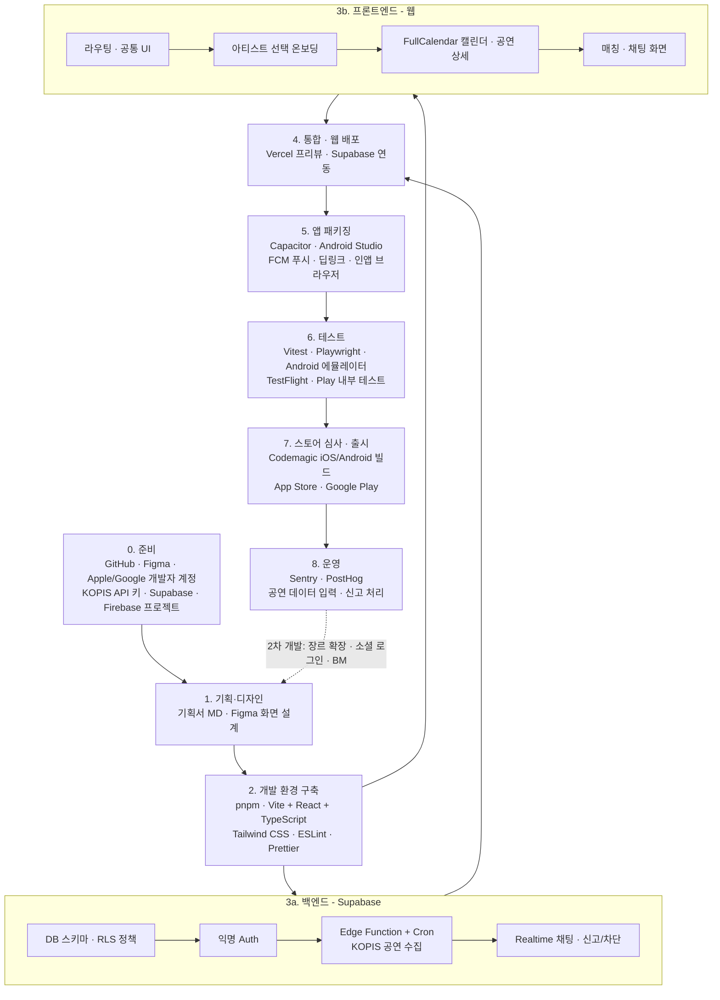
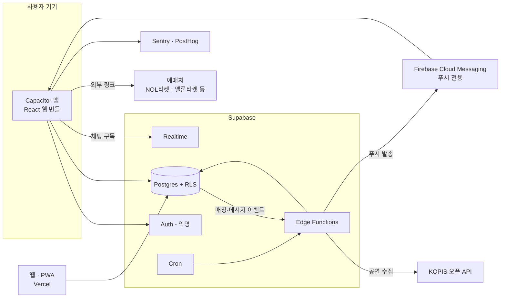
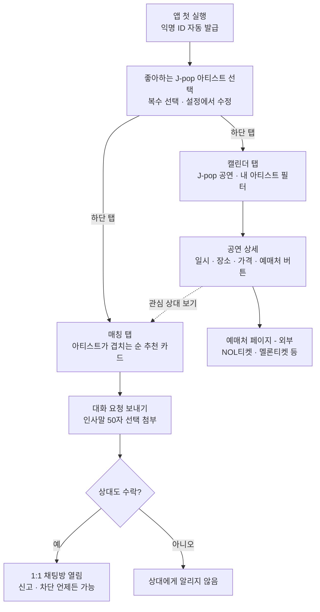

# 공연 캘린더·취향 매칭 앱 기획서

작성일: 2026-10-05 · 수정일: 2026-10-06 (초기 장르 J-pop 고정, 개발 흐름·툴 체계 추가)

## 1. 개요

덕친소(가칭)는 흩어진 콘서트·공연 일정을 한 캘린더에 모으고, 취향이 겹치는 사람끼리 상호 수락으로 연결해 "같이 갈 사람"을 찾게 해 주는 앱이다. 웹으로 먼저 만들고 하이브리드 패키징으로 Android·iOS에 동시 배포한다. **초기 버전은 J-pop 한 장르로 고정**하고, 장르 확장은 2차 이후에 한다.

**해결하려는 문제**

- J-pop 내한 공연 정보가 NOL티켓, 멜론티켓, 예스24티켓, 티켓링크, 각 기획사 SNS에 흩어져 있어 놓치기 쉽다.
- J-pop은 국내에서 취향층이 좁아 주변에 같이 공연 갈 사람이 없다.
- 기존 커뮤니티(오픈채팅, 카페)는 취향 단위 매칭이나 안전장치가 약하다.

**타깃 사용자**

- 1차: 20\~30대 J-pop 팬, 내한 공연을 보거나 보고 싶은 사람
- 2차: 혼공(혼자 공연) 경험이 있고 동행·친구를 찾는 사용자

**핵심 가치**

| 가치 | 사용자가 얻는 것 |
| --- | --- |
| 모아보기 | 여러 예매처의 J-pop 공연을 캘린더 하나로 확인 |
| 바로가기 | 공연 선택 → 해당 예매 페이지로 바로 이동 |
| 연결 | 좋아하는 아티스트가 겹치는 사람과 상호 수락 후 대화, 동행·친목 |

## 2. 개발·배포 방식

반응형 웹앱(SPA)을 만든 뒤 Capacitor로 감싸 Android(Google Play)와 iOS(App Store)에 배포한다. 코드 하나로 웹·Android·iOS 3개 채널을 운영하고, 푸시 알림·딥링크 등 네이티브 기능은 플러그인으로 보강한다. 세부 툴과 충돌 방지 규칙은 3장에 정리했다.

**패키징 방식 비교**

| 방식 | 장점 | 단점 | 판단 |
| --- | --- | --- | --- |
| Capacitor (권장) | 웹 코드 그대로 사용, 네이티브 플러그인(푸시, 공유, 브라우저) 풍부 | 복잡한 애니메이션은 네이티브보다 느림 | 채택 |
| 웹뷰 래퍼 직접 구현 | 구조 단순 | 네이티브 브리지를 직접 작성해야 함 | 유지보수 부담 |
| PWA만 운영 | 스토어 심사 없음 | iOS 설치·푸시 제약, 스토어 노출 없음 | 보조 채널로 병행 |
| React Native / Flutter | 네이티브에 가까운 성능 | 웹 코드 재사용 불가 | 현 방향과 맞지 않음 |

**스토어 심사 유의사항**

- Apple 가이드라인 4.2(최소 기능): 웹사이트를 감싼 것에 그치면 리젝될 수 있어 푸시 알림, 캘린더 저장, 네이티브 공유 등 앱다운 기능을 MVP에 넣는다.
- 가이드라인 1.2(사용자 생성 콘텐츠): 채팅이 있으므로 신고·차단·부적절 콘텐츠 필터링·운영자 연락처가 필수다.
- 소셜 로그인(구글·카카오)을 넣으면 iOS에는 Sign in with Apple(또는 동등한 프라이버시 로그인)도 검토해야 한다.
- 디지털 상품(구독, 프리미엄 매칭 등) 판매 시 인앱결제 정책이 적용된다(BM 설계에 영향).

## 3. 전체 개발 흐름과 툴 체계

모든 툴은 "Vite로 만든 정적 SPA + Supabase 하나의 백엔드 + Capacitor 하나의 패키징" 축에 맞춰 골랐다. 이 축에서 벗어나는 선택(SSR 프레임워크, 인증 시스템 이중화, UI 라이브러리 혼용)이 대부분의 충돌 원인이므로 3.4의 규칙으로 막는다. 설치 방법과 GitHub 운영 규칙은 [개발환경_및_GitHub_운영가이드.md](개발환경_및_GitHub_운영가이드.md)에 따로 정리했다.

### 3.1 개발 과정 흐름도

3a 백엔드와 3b 프론트엔드는 병행 개발하고, 4단계에서 합친 뒤 같은 웹 빌드를 Capacitor로 앱에 넣는다. 웹 배포와 앱 빌드는 같은 `dist` 결과물을 쓰므로 코드가 갈라지지 않는다.

### 3.2 시스템 구성도 (툴이 서로 연결되는 방식)

인증·데이터·실시간·서버 로직은 모두 Supabase가 맡고, Firebase는 푸시(FCM) 한 가지에만 쓴다. 예매는 외부 링크로만 넘기므로 결제·개인정보가 우리 시스템에 들어오지 않는다.

### 3.3 영역별 추천 툴 (추천도 순)

★ 표시가 채택안이며, 2·3순위는 채택안에 문제가 생겼을 때의 대안이다.

**① 프론트엔드 프레임워크**

| 순위 | 툴 | 장점 | 단점 |
| --- | --- | --- | --- |
| 1 ★ | React + Vite + TypeScript | 생태계·자료 최대, FullCalendar·Supabase·Capacitor 공식 예제 풍부, Vite 정적 빌드가 Capacitor와 바로 맞음 | 상태관리·라우팅 등을 직접 골라 조합해야 함 |
| 2 | Vue 3 + Vite | 학습 곡선 낮음, 공식 라우터·상태관리(Pinia) 제공 | 국내 채용·레퍼런스가 React보다 적음 |
| 3 | SvelteKit (static adapter) | 번들 작고 빠름 | 정적 모드 설정 필요, 라이브러리 선택지 적음 |

**② UI·스타일**

| 순위 | 툴 | 장점 | 단점 |
| --- | --- | --- | --- |
| 1 ★ | Tailwind CSS + shadcn/ui | 디자인 자유도 높음, 컴포넌트 코드를 프로젝트에 복사해 의존성 충돌 적음 | 모바일 네이티브 느낌(전환 애니메이션 등)은 직접 구현 |
| 2 | Ionic React | Capacitor 제작사 UI, iOS/Android 네이티브 느낌 컴포넌트 기본 제공 | 자체 라우터가 React Router 특정 버전에 묶여 있음(도입 시 버전 확인 필요), Tailwind와 혼용 시 스타일 충돌 |
| 3 | MUI | 컴포넌트 수 많음, 문서 충실 | 머티리얼 디자인 느낌이 강해 iOS에서 이질감, 번들 큼 |

**③ 캘린더**

| 순위 | 툴 | 장점 | 단점 |
| --- | --- | --- | --- |
| 1 ★ | FullCalendar (React) | 월/주/리스트 뷰 기본 제공, 이벤트 데이터 연동 쉬움 | 일부 고급 플러그인은 유료(본 서비스엔 불필요), 모바일 스타일 손질 필요 |
| 2 | react-big-calendar | 무료, 가벼움 | 모바일 대응·커스터마이즈 손이 더 감 |
| 3 | 직접 구현 (date-fns) | 디자인 완전 통제 | 개발 공수 큼 |

**④ 상태·서버 데이터 관리**

| 순위 | 툴 | 장점 | 단점 |
| --- | --- | --- | --- |
| 1 ★ | TanStack Query + Zustand | 서버 데이터 캐싱(Query)과 앱 상태(Zustand) 역할 분리 명확, 가벼움 | 두 개념을 구분해 써야 함 |
| 2 | Redux Toolkit (+ RTK Query) | 하나로 통합, 대규모에 강함 | 보일러플레이트 많음, 초기 단계에 과함 |
| 3 | SWR + React Context | 매우 단순 | 앱 상태가 늘면 관리 어려움 |

**⑤ 백엔드 (BaaS)**

| 순위 | 툴 | 장점 | 단점 |
| --- | --- | --- | --- |
| 1 ★ | Supabase | Postgres(관계형)라 공연·매칭 데이터에 적합, 익명 로그인 → 소셜 계정 연결 지원, 카카오 OAuth 기본 제공, Realtime·Edge Functions·Cron 한 곳에서 | 푸시 기능 없음(FCM 별도), 무료 플랜은 비활성 시 일시정지 |
| 2 | Firebase | 푸시·분석·인증 올인원, 모바일 레퍼런스 풍부 | NoSQL이라 매칭·필터 쿼리 설계가 까다로움, 카카오 로그인은 직접 구현(커스텀 토큰) 필요 |
| 3 | 자체 서버 (NestJS + Postgres) | 완전한 통제 | 인증·실시간·배포를 모두 직접 구축, 초기 공수 큼 |

**⑥ 푸시 알림**

| 순위 | 툴 | 장점 | 단점 |
| --- | --- | --- | --- |
| 1 ★ | FCM + @capacitor-firebase/messaging | Android·iOS 모두 FCM 토큰 하나로 통일, 무료 | iOS용 APNs 키를 Firebase에 등록해야 함 |
| 2 | FCM + @capacitor/push-notifications | Capacitor 공식 플러그인 | iOS에서는 APNs 토큰이 나와 서버가 플랫폼별로 분기해야 함 |
| 3 | OneSignal | 대시보드·세그먼트 발송 편리 | 외부 서비스 의존 추가, 사용자 데이터가 제3자에 저장 |

**⑦ 공연 데이터 수집 스케줄러**

| 순위 | 툴 | 장점 | 단점 |
| --- | --- | --- | --- |
| 1 ★ | Supabase Edge Functions + Cron | 백엔드와 같은 곳에서 실행, DB 직접 저장, 별도 서버 불필요 | KOPIS 응답(XML) 파싱 코드 직접 작성 |
| 2 | GitHub Actions 예약 실행 | 설정 간단, 로그 확인 쉬움 | DB 접속 비밀키를 GitHub에 보관해야 함 |
| 3 | 수동 입력만 | 구현 불필요 | 운영 인력 소모 |

**⑧ iOS 빌드·배포 (Windows 개발 환경 기준)**

iOS 앱 빌드에는 macOS + Xcode가 반드시 필요하다. 현재 개발 PC가 Windows이므로 아래 중 하나가 필요하다.

| 순위 | 툴 | 장점 | 단점 |
| --- | --- | --- | --- |
| 1 ★ | Codemagic (클라우드 CI) | Mac 없이 iOS·Android 빌드와 스토어 업로드 자동화, Capacitor 지원 | 무료 빌드 시간 한도, 서명 인증서 설정 학습 필요 |
| 2 | GitHub Actions macOS 러너 + fastlane | 코드 저장소와 한곳에서 관리 | macOS 러너 비용, 설정 난이도 높음 |
| 3 | Mac 직접 구매 (Mac mini 등) | Xcode로 직접 디버깅 가능, 시뮬레이터 사용 | 초기 비용 |

**⑨ 웹 호스팅**

| 순위 | 툴 | 장점 | 단점 |
| --- | --- | --- | --- |
| 1 ★ | Vercel | Git 푸시만으로 배포, PR별 프리뷰 URL, 딥링크용 `.well-known` 파일 배포 쉬움 | 무료 플랜 상업 이용 제한(유료 전환 필요 시점 확인) |
| 2 | Cloudflare Pages | 무료 한도 넉넉, 빠른 CDN | 설정 화면이 다소 복잡 |
| 3 | Netlify | Vercel과 비슷한 편의성 | 무료 한도 초과 시 비용 |

**⑩ 모니터링·분석**

| 순위 | 툴 | 장점 | 단점 |
| --- | --- | --- | --- |
| 1 ★ | Sentry + PostHog | 오류 추적(Capacitor SDK 제공) + 제품 분석(퍼널·리텐션)을 각각 전문 툴로 | 툴 두 개 관리 |
| 2 | Sentry + Firebase Analytics | 이미 FCM용 Firebase가 있어 추가 설정 적음 | 분석 화면이 퍼널 분석에 덜 직관적 |

**⑪ 관리자 도구 (공연 등록·신고 처리)**

| 순위 | 툴 | 장점 | 단점 |
| --- | --- | --- | --- |
| 1 ★ | Supabase Studio(초기) → 앱 내 관리자 페이지 | 추가 툴 없음, 같은 코드베이스 | 관리자 페이지 개발 공수 |
| 2 | Retool / Appsmith | 드래그로 관리 화면 빠르게 제작 | 외부 툴 비용·권한 관리 |

**공통 툴 (단일 선택)**: GitHub(코드·이슈), Figma(디자인), pnpm(패키지 매니저), ESLint + Prettier(코드 규칙), Vitest + Playwright(테스트), Android Studio(Android 빌드·에뮬레이터).

### 3.4 충돌 방지 규칙

각 행은 실제로 자주 생기는 충돌과 그것을 막는 규칙이다. 새 툴을 추가할 때 이 표에 먼저 대조한다.

| 충돌 지점 | 문제 | 규칙 |
| --- | --- | --- |
| SSR 프레임워크 vs Capacitor | Next.js 등 서버 렌더링 기능은 앱 안(정적 파일)에서 동작하지 않음 | Vite 정적 SPA만 사용, 서버 로직은 Supabase Edge Functions로 |
| 인증 시스템 이중화 | Supabase Auth와 Firebase Auth를 같이 쓰면 사용자 ID가 둘로 갈라짐 | 인증은 Supabase만. Firebase는 FCM(푸시) 전용으로 Auth 미설치 |
| 푸시 플러그인 중복 | 두 푸시 플러그인을 함께 설치하면 토큰·알림 수신이 서로 간섭 | @capacitor-firebase/messaging 하나만 설치 |
| UI 라이브러리 혼용 | Tailwind와 Ionic/MUI를 섞으면 리셋 CSS·테마가 충돌 | 스타일은 Tailwind + shadcn/ui 하나로 통일 |
| 소셜 로그인과 웹뷰 (2차) | 구글은 앱 내 웹뷰에서의 OAuth 로그인을 차단 | 로그인은 시스템 브라우저 또는 네이티브 로그인 플러그인으로 열고, 딥링크로 앱 복귀 |
| 딥링크 도메인 | Universal Links / App Links는 웹 도메인 검증 파일이 필요 | Vercel 도메인의 `/.well-known/`에 `apple-app-site-association`, `assetlinks.json` 배포 |
| Capacitor 플러그인 버전 | 플러그인 메이저 버전이 Capacitor 코어와 다르면 빌드 실패 | 코어·플러그인 메이저 버전 일치, 업그레이드는 한 번에 |
| 패키지 매니저 혼용 | npm·yarn·pnpm 잠금 파일이 섞이면 의존성 버전이 어긋남 | pnpm만 사용, `pnpm-lock.yaml`만 커밋 |
| 시간대 | 서버(UTC)와 기기(KST) 시간이 섞여 공연 날짜가 하루 밀림 | DB는 `timestamptz`(UTC) 저장, 화면은 Asia/Seoul로 변환 |
| 비밀키 노출 | 서비스 키가 앱 번들에 들어가면 누구나 DB 전체 접근 | 앱에는 anon 키만, 모든 테이블 RLS 필수, service role 키는 Edge Functions에서만 |
| 상태 관리 중복 | 서버 데이터를 Query와 Zustand 양쪽에 저장하면 값이 어긋남 | 서버 데이터는 TanStack Query, 화면 상태(필터·모달)만 Zustand |
| iOS 빌드 환경 | Windows에서는 iOS 빌드 불가 | iOS 빌드·업로드는 Codemagic으로 고정 |

### 3.5 채택 스택 요약

| 영역 | 채택 |
| --- | --- |
| 프론트엔드 | React + Vite + TypeScript, React Router |
| UI | Tailwind CSS + shadcn/ui |
| 캘린더 | FullCalendar |
| 상태·데이터 | TanStack Query + Zustand |
| 백엔드 | Supabase (Postgres, 익명 Auth, Realtime, Edge Functions, Cron) |
| 푸시 | FCM + @capacitor-firebase/messaging |
| 앱 패키징 | Capacitor (Browser, App, Share 플러그인) |
| 빌드·배포 | Android Studio(로컬), Codemagic(iOS·스토어 배포), Vercel(웹) |
| 모니터링 | Sentry + PostHog |
| 협업 | GitHub, Figma, pnpm |

## 4. 기능 범위와 단계별 로드맵

MVP는 "익명으로 들어와 좋아하는 J-pop 아티스트를 고르고, J-pop 공연을 캘린더에서 보고, 예매처로 이동하고, 매칭된 사람과 대화한다"까지를 담는다. 장르 확장·회원가입·BM은 2차 이후다.

| 기능 | MVP (1차) | 2차 | 3차 |
| --- | --- | --- | --- |
| 취향 선택 | 장르 J-pop 고정, 좋아하는 아티스트 선택(복수) | 장르 선택 개방(락, 국내 인디, 힙합 등) | 청취 이력 연동(스포티파이 등) 검토 |
| 공연 캘린더 | J-pop 공연 월/리스트 뷰, 아티스트·지역 필터, 상세 화면 | 관심 공연 찜, 예매 오픈 알림, 일본 현지 공연(원정) 검토 | 개인 캘린더(구글 등) 내보내기 자동화 |
| 예매 연결 | 예매처 페이지로 외부 링크 이동 | 예매처별 딥링크, 클릭 추적 | 제휴(제휴링크·API) 기반 수수료 |
| 취향 매칭 | 아티스트 유사도 추천, 상호 수락, 1:1 채팅 | 공연별 동행 모집, 그룹 채팅 | 오프라인 모임·후기 |
| 안전 | 신고·차단, 금칙어 필터, 이용수칙 동의 | 매너 점수, 자동 제재 | 본인인증 옵션 |
| 계정 | 기기 기반 익명 ID + 닉네임 | 구글·카카오·애플 로그인, 익명 데이터 이관 | 프로필 고도화 |
| BM | 없음(지표 수집만) | 광고·제휴 테스트 | 구독형 등 본격 수익화 |

## 5. 기능 상세 명세

### 5.1 좋아하는 아티스트 선택 (장르는 J-pop 고정)

초기 버전은 장르가 J-pop 하나뿐이므로 장르 대신 **좋아하는 J-pop 아티스트**가 캘린더 필터와 매칭의 기준이 된다. 최초 실행 시 아티스트를 1명 이상 고르면 앱을 쓸 수 있다.

- 아티스트 목록: 운영자가 관리하는 J-pop 아티스트 목록에서 검색·선택(내한 이력·예정 아티스트 우선 노출)
- 복수 선택(최대 10명 권장), 목록에 없으면 "아티스트 추가 요청"
- 설정에서 언제든 수정, 매칭 결과에 즉시 반영
- 장르 구조(genres 테이블)는 DB에 미리 만들어 두고 화면에는 노출하지 않음 → 2차 장르 확장 시 UI만 추가

### 5.2 공연 캘린더

J-pop 공연이 기본으로 모두 표시되고, "내 아티스트만" 필터로 좁힐 수 있다.

- 뷰: 월간(날짜별 점·개수 표시), 주간, 날짜 선택 시 하단 리스트
- 필터: 아티스트(내 아티스트 / 전체), 지역(서울·경기·부산 등), 예매 상태(오픈 예정 / 예매 중 / 매진)
- 공연 상세: 포스터, 공연명, 아티스트, 일시(회차별), 장소, 가격대, 예매 오픈일, 예매처 버튼(복수 가능)
- 예매 이동: 예매처 버튼 → 인앱 브라우저 또는 예매처 앱으로 이동(앱 링크 지원 시), 클릭 로그 기록
- 부가: 내 기기 캘린더에 저장, 공연 공유(링크), 이 공연에 관심 있는 매칭 상대 수 표시

### 5.3 취향 매칭과 대화 (상호 수락)

양쪽이 모두 수락해야만 채팅방이 열린다. 한쪽만 요청한 상태에서는 상대에게 메시지를 보낼 수 없다.

1. 추천: 아티스트 겹침 점수가 높은 사용자를 카드로 노출(닉네임, 겹치는 아티스트, 한줄 소개, 관심 공연)
2. 요청: "대화 요청" 또는 "넘기기". 요청에는 선택적으로 짧은 인사말(50자) 첨부
3. 수락: 상대가 받은 요청함에서 수락/거절. 거절은 상대에게 알리지 않음
4. 매칭 성립: 양쪽 수락 시 1:1 채팅방 생성 + 푸시 알림
5. 대화: 텍스트·이모지 중심(MVP에서는 사진 전송 제외 권장), 공연 카드 공유
6. 종료: 나가기, 차단, 신고 언제든 가능

**매칭 점수(초안)**: 아티스트 자카드 유사도(겹치는 아티스트 수 ÷ 합집합 아티스트 수)를 기본으로 하고, 같은 공연에 관심 표시·같은 지역·최근 접속에 가산점을 준다. 장르가 확장되면 장르 유사도를 상위 가중치로 추가한다.

**제한 규칙(초안)**: 하루 대화 요청 10건, 동시 대기 요청 20건, 거절·차단한 상대는 다시 추천하지 않음.

## 6. 화면 구성(IA)과 사용자 흐름

앱은 하단 탭 4개(캘린더, 매칭, 채팅, 설정)로 구성하고, 아티스트 선택 이후 "공연 찾기"와 "사람 찾기" 두 갈래로 나뉜다.

공연 쪽은 예매처로 나가면서 끝나고, 매칭 쪽은 양쪽이 모두 수락해야만 채팅방이 열린다. 공연 상세에서는 그 공연에 관심 있는 상대를 바로 볼 수 있다.

| 탭 | 주요 화면 |
| --- | --- |
| 캘린더 | 월간/주간 캘린더, 날짜별 공연 리스트, 필터 시트, 공연 상세 |
| 매칭 | 추천 카드, 받은 요청함, 보낸 요청 |
| 채팅 | 채팅방 목록, 채팅방(신고·차단·나가기 메뉴) |
| 설정 | 닉네임·소개, 아티스트·지역 수정, 알림, 차단 목록, 약관·문의 |

## 7. 데이터 수급·예매처 연동 전략

공연 데이터 확보가 이 서비스의 가장 큰 리스크다. J-pop 내한 공연은 전체 공연 중 일부라 양은 적지만 공공 데이터만으로는 J-pop 여부를 구분하기 어렵다. 따라서 MVP는 **운영자 입력을 중심으로 하고 KOPIS 수집으로 보완**하며, 예매처 제휴는 2차에 추진한다.

| 수급 방식 | 내용 | 장점 | 주의점 | 단계 |
| --- | --- | --- | --- | --- |
| 운영자 입력 | 관리자 화면에서 J-pop 공연·아티스트·예매 링크 등록 | 품질 통제, J-pop 판별 정확 | 인력 소요(공연 수가 적어 초기엔 감당 가능) | MVP 주력 |
| 공공 데이터 | KOPIS(공연예술통합전산망) 오픈 API에서 대중음악 공연 수집 후 J-pop 아티스트 목록과 대조 | 합법·무료, 누락 방지용 보조 | 장르가 대분류라 자동 판별 한계, 누락·지연 가능 | MVP 보조 |
| 사용자 제보 | 사용자가 공연 정보·링크를 제보, 운영자 검수 후 노출 | 커버리지 확대 | 검수 필요 | 2차 |
| 예매처 제휴 | NOL티켓, 멜론티켓, YES24티켓, 티켓링크 등과 데이터 제공·제휴링크 계약 | 정확한 데이터, 수수료 BM | 트래픽 입증 후 협상 가능 | 2\~3차 |
| 크롤링 | 예매처 웹페이지 자동 수집 | 커버리지 넓음 | 이용약관·robots 위반 및 법적 분쟁 소지, 페이지 변경에 취약 | 원칙적 미사용, 법률 검토 후 판단 |

**예매 페이지 이동 방식**

- MVP: 공연별 예매 URL을 저장해 두고 Capacitor Browser 플러그인(인앱 브라우저)으로 열기. 예매 결제는 전적으로 예매처에서 진행(우리 앱은 결제를 다루지 않음)
- 2차: 예매처 앱이 설치돼 있으면 앱으로 바로 열리도록 딥링크 지원, UTM·제휴 파라미터 붙여 전환 추적
- 예매처 로고·상표 사용은 제휴 전까지 텍스트 표기로 대체

**J-pop 판별**: 아티스트 테이블에 J-pop 아티스트를 운영자가 등록해 두고, KOPIS에서 들어온 공연의 출연진을 이 목록과 대조해 후보로 올린 뒤 운영자가 확정한다.

참고: KOPIS 오픈 API의 제공 항목·이용 조건과 각 예매처의 제휴 프로그램 유무는 개발 착수 전 직접 확인이 필요하다(본 문서는 미확인 상태).

## 8. 익명 사용자 식별과 안전 정책

회원가입 없이도 대화 상대를 구분하고 제재할 수 있어야 하므로, Supabase 익명 Auth가 발급하는 계정 ID를 사용하고 채팅에는 최소한의 안전장치를 MVP부터 넣는다.

**익명 식별**

- 앱 최초 실행 시 Supabase 익명 로그인으로 UID 발급, 기기에 세션 저장
- 사용자는 닉네임·기본 아바타·한줄 소개만 설정(실명, 연락처 미수집)
- 한계: 앱 삭제·기기 변경 시 계정 유실. 설정에 "복구 코드" 제공 여부 검토, 2차 소셜 로그인 시 익명 계정에 소셜 계정을 연결(데이터 이관)
- 악용 대응: 제재된 사용자가 앱 재설치로 우회하지 않도록 기기 식별값·패턴 기반 보조 제재 검토(개인정보 처리방침에 명시)

**채팅 안전장치 (MVP 필수)**

- [ ] 이용수칙·커뮤니티 가이드 동의(최초 매칭 전)
- [ ] 사용자 신고(사유 선택: 욕설, 성희롱, 사기·암표, 스팸, 기타)
- [ ] 차단(차단 시 상호 추천·대화 불가)
- [ ] 금칙어·연락처·외부 링크 필터 및 경고
- [ ] 운영자 제재 도구(신고 큐, 경고·정지)
- [ ] 연애·만남 목적 운영 금지 안내, 첫 만남은 공연장 등 공개 장소 권장 문구

**법·정책 검토 항목**

- 개인정보 처리방침 및 수집 항목 최소화(닉네임, 아티스트, 지역 선택값, 채팅 내용, 푸시 토큰)
- 나이 제한: 낯선 사용자 간 대화 기능이 있어 만 14세 미만 이용 제한 및 스토어 연령 등급 설정
- 정확한 위치(GPS)는 수집하지 않고 사용자가 고른 시·도 단위 지역만 사용(위치정보법 부담 회피)
- 채팅 로그 보관 기간 결정(신고 대응용), 탈퇴·삭제 시 처리 기준

## 9. 데이터 모델 초안

MVP는 아티스트 중심으로 구현하되, 장르 테이블을 미리 두어 2차 장르 확장 때 스키마 변경 없이 화면만 추가한다. 모든 테이블에 RLS(행 단위 보안)를 적용한다.

| 테이블 | 주요 컬럼 | 비고 |
| --- | --- | --- |
| users | id, nickname, bio, region, auth_type(anonymous/google/kakao/apple), status, created_at | Supabase Auth 사용자와 1:1 |
| genres | id, name, sort_order, is_active | MVP는 J-pop 1건만 활성 |
| artists | id, name, name_ja, genre_id, image_url | 운영자 관리, J-pop 판별 기준 |
| user_artists | user_id, artist_id, priority | 매칭 점수 계산 기준 |
| user_genres | user_id, genre_id | 2차 장르 확장 대비(MVP는 J-pop 자동 저장) |
| concerts | id, title, venue, region, poster_url, price_range, ticket_open_at, source, status | source = 운영자/KOPIS/제보 |
| concert_artists | concert_id, artist_id | 출연 아티스트(복수) |
| concert_schedules | concert_id, starts_at(timestamptz) | 회차별 일시(캘린더 표시 단위) |
| ticket_links | concert_id, vendor(nol/melon/yes24/ticketlink/기타), url, deeplink | 클릭 로그는 별도 이벤트 테이블 |
| match_requests | id, from_user, to_user, message, status(pending/accepted/declined/expired), created_at | 양방 수락 시 chat_rooms 생성 |
| chat_rooms / messages | room_id, members, created_at / room_id, sender_id, body, created_at | Realtime 구독 |
| reports / blocks | reporter, target, reason, room_id / blocker, blocked | 추천·채팅에서 제외 처리 |
| push_tokens | user_id, fcm_token, platform, updated_at | Edge Function이 FCM 발송 시 사용 |

## 10. 향후 계획: 장르 확장, 회원가입, BM

2차에서 장르 선택을 개방하고(락, 국내 인디, 힙합 등), 회원가입은 익명 계정에 소셜 계정을 연결하는 방식으로 도입한다. BM은 MVP 지표를 본 뒤 arena 스킬로 후보를 경쟁시켜 확정한다.

**회원가입(2차)**

- 지원 계정: 구글, 카카오(Supabase 기본 지원), (iOS) 애플. 네이버는 수요 보고 추가
- 익명 → 회원 전환 시 아티스트·찜·매칭·채팅 이력 유지(계정 연결)
- 회원 전용 혜택 후보: 기기 간 동기화, 예매 오픈 알림, 그룹 채팅 참여

**BM 후보 (추후 arena로 재검토)**

| 후보 | 방식 | 선행 조건 |
| --- | --- | --- |
| 예매 제휴 수수료 | 예매처 연결 후 구매 전환 시 수수료 | 예매처 제휴 계약, 클릭 데이터 |
| 프리미엄 구독 | 예매 오픈 우선 알림, 매칭 요청 한도 확대, 고급 필터 | 회원가입, 인앱결제 |
| 광고·프로모션 | 기획사·공연장의 공연 상단 노출(표기된 광고) | 사용자 규모 |
| 데이터 인사이트 | 아티스트·지역별 수요를 기획사에 리포트(개인 식별 불가 통계) | 사용자 동의, 충분한 표본 |
| 굿즈·패키지 | 공연 + 동행 모임 기획, 한정 굿즈 | 커뮤니티 활성화 |

## 11. 성공 지표, 리스크, 미결 사항

성공 여부는 "캘린더에서 예매처로 넘어가는가"와 "매칭이 실제 대화로 이어지는가" 두 가지로 판단한다. 목표 수치는 베타 데이터를 본 뒤 정한다.

**핵심 지표(KPI)**

| 지표 | 정의 |
| --- | --- |
| 주간 활성 사용자(WAU) | 7일 내 앱 실행 사용자 수 |
| 예매 이동률 | 공연 상세 조회 대비 예매처 버튼 클릭 비율 |
| 매칭 수락률 | 보낸 대화 요청 대비 수락 비율 |
| 대화 지속률 | 매칭 후 양쪽이 각 3개 이상 메시지를 보낸 채팅방 비율 |
| D7 리텐션 | 설치 7일 후 재방문 비율 |
| 신고율 | 채팅방 100개당 신고 건수(낮을수록 좋음) |

**주요 리스크와 대응**

| 리스크 | 영향 | 대응 |
| --- | --- | --- |
| J-pop 공연 데이터 부족·누락 | 핵심 가치 붕괴 | 운영자 입력 중심 + KOPIS 대조, 내한 공연 일정 SNS 모니터링 |
| J-pop 공연이 적어 캘린더가 비어 보임 | 재방문 감소 | 공연 외 이벤트(팬미팅, 상영회, 페스티벌 출연) 포함 검토, 2차 장르 확장 |
| 초기 사용자 부족으로 매칭 안 됨(콜드 스타트) | 채팅 기능 무의미 | J-pop 팬 커뮤니티 대상 타깃 런칭, 대형 내한 공연 시점에 홍보 |
| 익명 채팅 악용(사기·암표·성희롱) | 사용자 이탈, 스토어 제재 | 상호 수락, 신고·차단, 필터, 제재 도구 |
| iOS 심사 리젝(웹뷰 앱) | 출시 지연 | 푸시·캘린더 저장 등 네이티브 기능 포함, UGC 요건 충족 |
| 툴 간 충돌 | 빌드 실패, 데이터 불일치 | 3.4 충돌 방지 규칙 준수, 새 툴 도입 시 표에 대조 |
| 예매처 상표·약관 문제 | 법적 분쟁 | 크롤링 미사용, 링크 이동만, 제휴 추진 |

**미결 사항**

- [x] MVP 장르 범위: J-pop 고정 (2026-10-06 결정)
- [ ] 서비스명 확정(현재 가칭 "덕친소")
- [ ] 초기 J-pop 아티스트 목록 범위(몇 명, 선정 기준)
- [ ] KOPIS 등 공공 데이터의 J-pop 내한 공연 커버리지 확인
- [ ] iOS 빌드 방식 최종 확정(Codemagic vs Mac 구매)
- [ ] 나이 제한 기준과 스토어 연령 등급
- [ ] 채팅 로그 보관 기간

## 12. 개발 착수 전 확정 필요 항목

현재 기획서는 "무엇을 만들지"는 정해졌지만, 코드로 옮길 때 바로 필요한 값과 규칙이 일부 비어 있다. 아래 A는 해당 기능 개발 전에 반드시 정하고, B는 개발과 병행해 출시 전까지 정한다. (2026-10-30 추가)

### A. 개발 전 확정 (정하지 않으면 작업이 막히거나 다시 해야 함)

| 항목 | 정할 내용 | 막히는 작업 |
| --- | --- | --- |
| 앱 ID(번들 ID)·앱 이름 | `com.<회사>.<앱>` 형식, 서비스명 | Capacitor 초기화, 스토어 등록. 출시 후 변경 불가 |
| 초기 J-pop 아티스트 시드 목록 | 아티스트 이름(한·일·영 표기), 몇 명, 선정 기준 | 온보딩 화면, 매칭 점수, KOPIS 대조 |
| 화면 목록과 상태 | 화면별 빈 화면·로딩·오류 상태, 화면 간 이동 | 프론트엔드 전체. 운영 방안 HTML의 디자인 예시를 출발점으로 확정 |
| 디자인 기본값 | 색상·글꼴·간격·컴포넌트 규칙, 다크 모드 지원 여부 | Tailwind 설정, 공통 UI |
| 매칭 세부 규칙 | 점수 공식 확정, 요청 만료 기간, 하루·대기 요청 한도 숫자, 차단 해제 가능 여부, 상대가 나간 대화방 처리 | match_requests 스키마, RLS 정책 |
| 지역 목록 | 시·도 단위 목록과 표기 | users·concerts의 region 값, 필터 |
| 데이터 필수값 | 공연 게시에 꼭 필요한 필드, 매진·취소 표시 방법 | concerts 스키마, 관리자 입력 화면 |
| 익명 계정 복구 | 복구 코드 제공 여부 | 익명 Auth 흐름, 설정 화면 |
| 지원 범위 | 최소 Android·iOS 버전, 태블릿 지원 여부 | Capacitor 설정, 테스트 범위 |

### B. 개발과 병행, 출시 전까지 확정

| 항목 | 정할 내용 | 필요한 시점 |
| --- | --- | --- |
| 이용약관·개인정보 처리방침·커뮤니티 가이드 | 수집 항목, 보관 기간, 금지 행위, 연령 제한 | 스토어 제출 필수 |
| 신고 처리 기준표 | 위반 유형별 경고·정지 기준 | 관리자 신고 화면 |
| 금칙어·필터 기준 | 금칙어 목록, 연락처·링크 감지 규칙, 경고 문구 | 채팅 필터 Edge Function |
| 알림 정책 | 푸시를 보낼 이벤트, 야간 발송 제한, 알림 권한 요청 시점 | FCM 연동 |
| 이벤트 트래킹 계획 | KPI 계산용 이벤트 이름·속성(예: 공연 상세 조회, 예매 버튼 클릭, 요청·수락) | PostHog 연동. 출시 후 추가하면 초기 데이터 유실 |
| MVP 일정·우선순위 | 기능별 순서와 마일스톤, GitHub Issues로 분할 | 첫 스프린트 시작 시 |
| 스토어 등록 자료 | 앱 설명, 스크린샷, 아이콘, 연령 등급 설문 답변 | 스토어 제출 |
