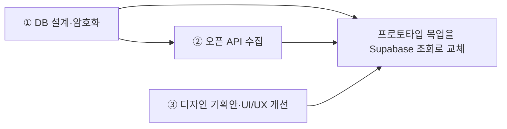

# 덕친소 다음 작업 계획

작성일: 2026-10-31 · 기준: 기획서(2026-10-30), 웹 프로토타입(목업 데이터)

## 진행 순서

| 순서 | 작업 | 이유 |
| --- | --- | --- |
| 1 | DB 설계·암호화 | 공연·아티스트 수집 결과와 사용자 데이터가 모두 이 테이블에 저장된다 |
| 2 | 오픈 API 수집 | 테이블이 있어야 수집 함수가 저장할 곳이 생긴다 |
| 1과 병행 | 디자인 기획안 | 데이터와 무관하게 진행 가능, 결과는 토큰 파일(`src/styles/index.css`)만 교체 |

---

## ① 사용자 DB 설계 및 암호화

**목표:** 기획서 12장 데이터 모델을 Supabase 마이그레이션(SQL)으로 만들고, 행 단위 접근 권한(RLS)과 암호화 방침을 확정한다.

**작업**

- [ ] `supabase/migrations/`에 테이블 생성 SQL 작성 (users, consents, user_artists, match_requests, chat_rooms, chat_members, messages, blocks, reports, sanctions, push_tokens, app_settings)
- [ ] 테이블마다 RLS 정책 작성: 본인 행만 읽기·쓰기, 채팅은 참여자만, 신고·제재는 운영자만
- [ ] 차단 관계가 있으면 추천·요청·메시지가 막히도록 정책·함수에 반영
- [ ] 하루 요청 한도·3일 만료를 DB 함수와 Cron으로 처리 (클라이언트 계산에 의존하지 않음)
- [ ] 계정 삭제 시 지울 데이터와 법령상 보관할 데이터(신고·제재 기록) 구분
- [ ] 로컬 Supabase(Docker)에서 마이그레이션·RLS 테스트

**암호화 방침 (초안)**

| 대상 | 방식 | 비고 |
| --- | --- | --- |
| 전송 구간 | HTTPS(TLS) | Supabase·Vercel 기본 |
| 저장 데이터 전체 | 디스크 암호화(AES-256) | Supabase 기본 제공 |
| 비밀번호 | Supabase Auth가 해시 저장 | 직접 저장하지 않음 |
| 이메일 등 계정 식별 정보 | Supabase Auth(`auth.users`)에만 저장 | 앱 테이블에 복사하지 않음 |
| API 키·서버 비밀값 | Supabase Vault / Edge Function 환경 변수 | 앱 번들에는 anon key만 |
| 채팅 메시지 | 저장 암호화 + RLS, 종단간 암호화는 하지 않음 | 신고 처리 시 운영자가 내용을 확인해야 하므로 |
| 운영자 열람 | 신고된 대화만, 열람 기록 남김 | 개인정보 처리방침에 명시 |

> 결정 필요: 채팅 보관 기간(예: 대화방 종료 후 N개월 삭제), 운영자 열람 범위. 법률 검토 대상(기획서 9장).

---

## ② 실제 공연·아티스트 정보 수집 (오픈 API)

**공연: KOPIS 공연예술통합전산망 오픈 API**

- [ ] 서비스 키 발급 (kopis.or.kr, 무료)
- [ ] 공연 목록 API에서 장르 "대중음악"·기간 조건으로 수집
- [ ] J-pop 판별: 등록된 아티스트 이름(한·일·영 표기)과 공연명 대조 → 애매한 건은 운영자 검수 대기열
- [ ] 공연 상세 API에서 장소·일시·예매처 링크(제공되는 경우) 저장
- [ ] 예매 오픈 일시는 KOPIS에 없을 수 있음 → 운영자 입력 화면 필요 (예매처 사이트 크롤링은 약관 문제로 하지 않음)
- [ ] Supabase Edge Function + Cron으로 매일 수집, 기존 데이터와 비교해 변경분만 반영

**아티스트: Apple Music API (1안)**

- [ ] Apple Developer Program 가입(유료) 및 MusicKit 키(.p8) 발급
- [ ] 아티스트 검색·정보 조회 후 `artists.apple_music_id`로 저장
- [ ] 약관상 메타데이터 저장·표시 범위 확인
- [ ] 사용 불가 시 대안: MusicBrainz(무료, 일본어·한국어 별칭 제공) → 그래도 불가 시 목록 보류(기획서 5.1)

> 결정 필요: Apple Developer 가입 시점(iOS 출시에도 필요하므로 앞당기는 것을 권장).

---

## ③ 프론트엔드 디자인으로 UI/UX 개선

- [x] frontend-design 스킬로 디자인 방향(분위기·색·글꼴·아이콘) 정리 → `docs/디자인_기획안.md`
- [x] 결과를 토큰(`src/styles/index.css`)에 반영하고, 부품(`src/components/ui`) → 조합 부품 → 화면 순서로 다듬기
- [ ] 화면별 개선 점검: 캘린더 가독성, 공연 상세 버튼 위계, 매칭 카드 정보량, 채팅 숨기기 제스처 안내
- [ ] 접근성: 글자 대비, 터치 영역 44px 이상, 스크린리더 이름표
- [ ] 이후 기존 운영방안 HTML의 디자인 예시는 새 디자인 기준으로 다시 제작

---

## 작업 관리

- 각 체크 항목을 GitHub Issue로 등록하고, 작업 브랜치(`feat/db-schema`, `feat/kopis-sync`, `design/tokens` 등) → PR → Squash merge
- 비밀값(KOPIS 키, Apple .p8, Supabase service role key)은 커밋하지 않고 `.env.example`에 이름만 추가
