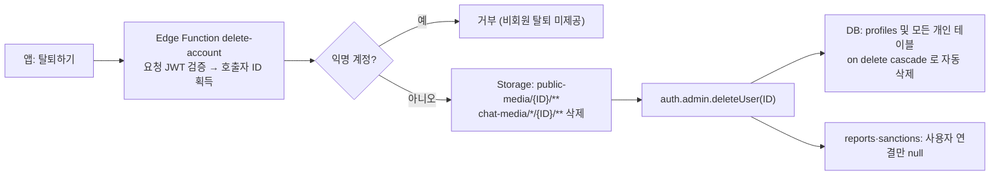

# 덕친소 보안·회원정보 처리 기획서

작성일: 2026-11-03 · 적용 위치: `supabase/migrations/`, `supabase/functions/`, `src/api/supabaseApi.ts`

인앱 상세 기획의 요구사항을 다룬다:

- 데이터베이스 보안 처리
- 회원가입 시 개인정보 수집·이용 동의
- 회원정보 저장 방식과, 그 방식에 따른 저장·삭제 방법
- 탈퇴 중 다른 사용자의 정보가 지워지지 않도록 개인별 데이터를 구분하는 방법

## 1. 회원정보 저장 방식 (먼저 정하는 원칙)

**한 사람 = `auth.users.id`(UUID) 하나.** 모든 개인 데이터는 이 ID 하나로 묶는다.

| 계층 | 저장 위치 | 담는 정보 | 누가 다루나 |
| --- | --- | --- | --- |
| 인증 | Supabase Auth `auth.users` | 이메일, 비밀번호(해시), 소셜 계정 연결 정보, 익명 여부 | Supabase Auth만. 앱 테이블에 복사하지 않음 |
| 프로필 | `public.profiles` (id = auth.users.id) | 닉네임, 소개글, 프로필·배너 사진 주소, 회원/비회원 구분, 상태 | 본인만 수정, 로그인 사용자는 공개 항목 열람 |
| 개인 활동 | `consents`, `user_artists`, `user_genres`, `favorites`, `posts`, `comments`, `post_likes`, `chat_members`, `messages`, `friend_requests`, `friendships`, `blocks`, `inquiries`, `push_tokens` | 동의 이력, 취향, 관심 공연, 글·댓글, 채팅, 친구 관계 등 | 모두 `profiles(id) on delete cascade` 로 연결 |
| 파일 | Storage `public-media/{내 ID}/…`, `chat-media/{방 ID}/{내 ID}/…` | 사진 | 경로 첫 폴더(또는 두 번째 폴더)가 내 ID일 때만 올리기·지우기 |
| 법령상 보관 | `reports`, `sanctions` | 신고·제재 기록 | 탈퇴 시 사용자 연결만 끊고(`on delete set null`) 행은 보관 |

- **비밀번호는 직접 저장하지 않는다.** Supabase Auth가 bcrypt 해시로 저장한다.
- **이메일은 `auth.users`에만 있다.** 앱 테이블(profiles 등)에는 이메일이 없다. 이메일이 필요한 곳(문의 답변 메일)은 서버 함수가 service role로 그때그때 조회한다.
- **회원과 비회원은 별개의 계정이다.** 비회원은 Supabase 익명 로그인(`is_anonymous = true`)으로 만든다. 같은 사람이라도 비회원으로 쓰다가 회원으로 로그인하면 다른 ID가 되며, 커뮤니티 규약 동의도 계정마다 따로 받는다(인앱 상세 기획).

## 2. 저장 방식

1. 가입(익명 포함) 순간 DB 트리거 `handle_new_user`가 `profiles` 행을 같은 ID로 만든다. 비회원은 "익명의 팬0000" 닉네임을 발급한다.
2. 이후 모든 쓰기는 RLS 정책을 거친다. 정책은 예외 없이 `auth.uid()`(요청 토큰에서 꺼낸 ID)와 행의 소유자 열을 비교한다.
   - 예: `user_artists insert`는 `with check (user_id = auth.uid())`이므로 남의 ID로는 행을 만들 수 없다.
3. 여러 행을 함께 바꿔야 하는 동작은 `security definer` 함수로만 연다. 예를 들어 친구 수락 하나에 요청 상태 변경, 친구 관계, 대화방, 참여자, 시스템 메시지가 함께 바뀐다.
   - 이 함수들은 사용자 ID를 인자로 받아도 "내가 아닌 그 사람의 데이터"를 바꾸지 않는다. 예: `respond_friend_request`는 `to_user = auth.uid()`인 요청만 처리한다.
4. 상태 열(`status`, `is_guest`)은 열 단위 권한(`grant update (…)`)에서 빠져 있다. 따라서 사용자가 자기 계정의 정지 상태를 풀거나 회원 구분을 바꿀 수 없다.

## 3. 삭제 방식 (회원탈퇴)

**다른 사람의 정보가 지워지지 않는 이유**

- 탈퇴 함수는 **요청 본문을 읽지 않는다.** 지울 ID는 오직 검증된 로그인 토큰에서만 나온다. 따라서 앱 버그나 조작된 요청으로 다른 ID를 넘길 방법이 없다.
- DB 삭제는 `auth.users`에서 **행 하나**를 지우는 것뿐이다. 나머지는 외래 키 `on delete cascade`가 그 ID를 참조하는 행만 따라 지운다. 다른 사람의 ID를 가진 행은 참조 경로에 없다.
- 두 사람이 함께 쓰는 데이터는 이렇게 처리한다.
  - 대화방: 내 참여 행(`chat_members`)과 내가 보낸 메시지만 지워진다. 상대의 메시지와 방은 남고, 상대 화면에는 "알 수 없음 / 보낼 수 없음"으로 표시된다.
  - 친구 관계·요청: 행 자체가 나를 참조하므로 함께 지워진다. 상대 쪽에서도 자연히 사라진다.
  - 다른 사람 글에 단 내 댓글·추천: 지워지고, 카운터는 트리거가 줄인다.
- 검증: `supabase/migrations`를 PGlite(Postgres)에 올려 사용자 A를 삭제했다. B·C의 프로필·취향·글은 그대로였고, A의 댓글은 사라졌으며, 신고 기록은 보존됐다. 테스트 스크립트는 배포 가이드 6장에 있다.

**비회원 계정**

- 앱 안 탈퇴 기능이 없다(인앱 상세 기획). 로그아웃하면 그 계정으로 다시 들어올 수 없다는 점을 로그아웃 확인 창에 알린다.
- 마지막 접속 후 180일(`app_settings.guest_inactive_delete_days`)이 지나면 매일 도는 정리 작업 `run_maintenance()`가 `auth.users`에서 삭제한다. 삭제 범위는 회원탈퇴와 같다(cascade).
- 알려진 한계: 비회원이 올린 사진 파일은 이 정리 작업으로 지워지지 않는다. Storage API를 거쳐야 하기 때문이다. 비회원 사진 업로드가 늘면 정리 작업을 Edge Function으로 옮긴다(`20261103000003_jobs.sql` 주석).

## 4. 개인정보 수집·이용 동의

- **비회원:** "비회원으로 시작" → 동의 화면 → 동의 후 익명 계정 생성 (기획서 9장 순서 유지)
- **이메일 가입:** 가입 양식 안에서 함께 동의 → 계정이 생긴 직후 동의 이력 저장
- **소셜 로그인(구글·애플·카카오):** 첫 로그인 직후 동의 화면을 거쳐야 앱에 들어간다

| 구분 | 항목 |
| --- | --- |
| 필수 | 만 14세 이상, 서비스 이용약관, 개인정보 수집·이용(항목·목적·보관 기간 표), 운영정책 및 계정 제재 고지 |
| 선택 | 서비스 알림, 광고성 정보 수신, 야간 광고성 정보 수신(광고성 동의자만) |
| 커뮤니티 | 커뮤니티 이용 규약(커뮤니티 첫 진입 시, 계정별) |

- 동의는 `consents` 테이블에 **항목·값·약관 버전·시각**을 행으로 쌓는다. 철회도 새 행이다.
  - "현재 동의 상태"는 항목별 최신 행이다. 따라서 동의 내역이 고정 문구가 아니라 실제 기록에서 나온다. (UI/UX 검토 문제점 A2 해결)
- 약관이 바뀌면 `CONSENT_VERSION`(앱)과 `app_settings.consent_version`을 함께 올린다. 그러면 다음 실행 때 필수 항목 재동의 화면이 뜬다.
- 수집 항목 표는 `src/data/consent.ts`의 `privacy.table`에 있고, 동의 화면에서 펼쳐 볼 수 있다.

## 5. 접근 권한 요약 (RLS)

| 데이터 | 읽기 | 쓰기 |
| --- | --- | --- |
| 공연·아티스트·장르 | 누구나(게시된 공연만) | 운영자(`admins`) |
| 프로필 | 로그인 사용자(영구 정지 제외) | 본인, 허용된 열만 |
| 취향·관심 공연 | 로그인 사용자(프로필 공개용) | 본인 |
| 친구 요청·관계 | 당사자 둘 | 함수로만 |
| 대화방·메시지 | 참여자 (운영팀 방은 운영자도) | 참여자 + 친구 관계 + 차단 없음 (`can_send`) |
| 채팅 사진 | 대화방 참여자 (비공개 버킷, 1시간 서명 URL) | 참여자, 경로에 내 ID |
| 글·댓글 | 로그인 사용자, 차단 관계는 서로 안 보임 | 커뮤니티 규약 동의한 활성 계정 |
| 신고 | 운영자 | 본인 이름으로 접수만, 원문은 서버가 복사 |
| 문의 | 본인·운영자 | 본인 |
| 차단 목록 | 차단한 사람만 (상대는 알 수 없음) | 함수로만 |

## 6. 암호화와 비밀값

| 대상 | 방식 |
| --- | --- |
| 전송 | HTTPS(TLS 1.2+). Supabase·Vercel 기본 |
| 저장 데이터 전체 | Supabase 디스크 암호화(AES-256) |
| 비밀번호 | Supabase Auth bcrypt 해시 |
| 앱 번들 | anon 키만. service role, KOPIS 키, 메일 키는 Edge Function 비밀값(`supabase secrets`)과 Vault에만 |
| 채팅 | 저장 암호화 + RLS. 종단간 암호화는 하지 않는다(신고 시 운영자가 신고된 내용을 확인해야 하므로. 처리방침에 명시) |
| 사진 | 올리기 전 앱에서 다시 그려 EXIF(촬영 위치 등)를 제거하고 1280px로 줄인다 (`src/lib/image.ts`) |

## 7. 회원가입 본인인증 (예정, 이 문서에서 함께 진행)

요청: 회원가입 때 실명 확인. PASS·인증서 등과 연계한다. 아직 코드에 넣지 않았다. 아래 결정이 끝나면 한 번에 적용한다.

**방식 후보**

| 방식 | 연동 경로 | 비고 |
| --- | --- | --- |
| 휴대폰 본인확인 (PASS 포함) | 본인확인 대행사(PortOne 통합인증, KG이니시스, NICE평가정보, 드림시큐리티 등) | 가장 일반적. 건당 수수료(대략 수십 원대, 계약별). 사업자등록 필요 |
| 민간 인증서 (카카오·네이버·토스·PASS 인증서) | 같은 대행사의 간편인증 상품 | 대행사 하나로 휴대폰 인증과 함께 받을 수 있다 |
| 공동인증서 | 대행사 | 모바일 이용자에게 불편해 우선순위 낮음 |

**적용 설계 (안)**

1. 회원 가입(소셜·이메일) 직후, 동의 화면 다음에 "본인인증" 단계를 둔다. 비회원은 대상이 아니다(커뮤니티 이용 범위는 따로 정한다).
2. 앱은 대행사 창을 열고, 결과 토큰만 받는다. 토큰 검증과 결과 조회는 Edge Function(`verify-identity`)에서 대행사 비밀키로 한다. 앱 번들에 비밀키를 넣지 않는다.
3. 저장하는 값: `identity_verified_at`, 출생연도(만 14세 확인), **CI의 해시**(중복 가입·재가입 제한용). 실명·휴대폰 번호·생년월일 전체는 저장하지 않는다(최소 수집).
4. CI 해시는 탈퇴 시에도 제재 회피 방지를 위해 일정 기간 보관할지 결정이 필요하다. 보관한다면 처리방침과 동의서에 별도 항목으로 고지한다.
5. 동의서에 "본인확인 정보 처리"와 대행사로의 위탁을 추가한다. 개인정보처리방침의 위탁 업체 목록도 갱신한다.

**필요한 결정**

- 대행사 선정과 계약(사업자등록 후)
- 본인인증을 가입 필수로 할지, 친구 요청·채팅처럼 특정 기능에만 요구할지
- CI 해시 보관 여부와 기간
- 주민등록번호 처리 금지 원칙 유지 (CI로 대체)

## 8. 법률 검토가 필요한 부분 (미결)

- 약관·처리방침·커뮤니티 규약 문안: 초안이며 법률 검토 전이다. 커뮤니티 규약의 면책 문구는 약관규제법을 고려해 "당사자 간 문제는 당사자가 해결, 회사는 신고 처리·수사 협조"로 바꿨다. "경고 없이 제재" 문구도 운영정책의 제재 기준과 맞는지 검토가 필요하다.
- 신고 원문 보관 기간(현재 안: 처리 후 1년)과 제재 기록 보관 기간
- 운영자의 신고 대화 열람 범위와 열람 기록 방식 (통신비밀보호법)
- 비회원 180일 삭제 기준을 처리방침에 공개
