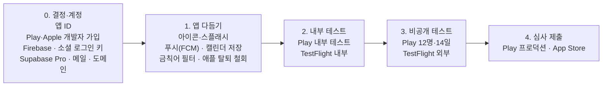

# 덕친소 Android·iOS 배포 계획

작성일: 2026-11-05 · 기준: 기획서 2장(개발·배포 방식, 지원 OS, 스토어 심사 유의사항), 3장 ⑩(iOS 빌드), 14장 미결 사항, 현재 코드

웹(React + Vite) 빌드 하나를 Capacitor로 감싸 Android(Google Play)와 iOS(App Store)에 낸다. 서버는 Supabase 하나다. 실행 명령과 서버 설정은 [배포_가이드.md](배포_가이드.md)에 있고, 이 문서는 **스토어 출시까지 무엇을 언제 하는지**를 정리한다.

## 1. 지금 상태 (2026-11-05)

| 항목 | 상태 | 비고 |
| --- | --- | --- |
| 백엔드 | 완료 | Supabase `DuckChinSo`, 마이그레이션 1~10 적용, 함수 5개 배포, 정기 수집 동작 |
| Android 프로젝트 | 생성됨 | minSdk 26 / target·compile 36, 로그인 복귀 스킴 등록. **아직 빌드 못 함(JDK 21 필요)** |
| iOS 프로젝트 | 생성됨 | iOS 16+, 사진·카메라 권한 문구, 로그인 복귀 스킴, 수출 규정 면제 표시(2026-11-05 추가) |
| 앱 ID | **임시값** | `com.duckchinso.app`. 스토어에 한 번 등록하면 바꿀 수 없다 |
| 앱 아이콘·스플래시 | **기본값** | 로고·아이콘 시안만 있음(`design/brand`) |
| 계정 삭제 | 완료 | 앱 MY > 회원탈퇴 + 웹 안내 `/legal/delete-account` |
| 개인정보처리방침·이용약관 URL | 완료(초안) | `/legal/privacy`, `/legal/terms`. 문안은 법률 검토 전 |
| 신고·차단·운영자 연락 | 완료 | 신고·제재·문의 운영자 화면 |
| 푸시 알림 | **설계 완료, 개발 전** | [푸시_알림_설계.md](푸시_알림_설계.md). `push_tokens` 테이블과 동의 항목은 있음 |
| 기기 캘린더 저장 | **없음** | 기획서의 Apple 4.2 대응 기능 |
| 부적절 콘텐츠 필터 | 완료 (마이그레이션 10 적용) | [금칙어_필터_설계.md](금칙어_필터_설계.md). 글·댓글·프로필 거절, 채팅 가림 |
| 소셜 로그인 | 버튼만 | **1차 출시에 구글·카카오·애플 모두 포함(2026-11-05 결정)**. 키 미설정 |

## 2. 출시를 막는 것과 해결 방법

| # | 막는 것 | 근거 | 해결 | 누가 |
| --- | --- | --- | --- | --- |
| 1 | 앱 ID 미확정 | 스토어 등록 후 변경 불가 | `com.duckchinso.app` 그대로 쓸지, 회사 도메인(예: `kr.회사.duckchinso`)으로 할지 결정 → 바꾸면 4곳 수정(배포 가이드 5장) | 결정: 사용자 / 반영: 개발 |
| 2 | 웹을 감싼 앱으로 보일 위험 | Apple 4.2 최소 기능 | **푸시 알림(FCM)** 과 **관심 공연 → 기기 캘린더 저장**을 넣는다. 예매처·지도 외부 앱 열기는 이미 있음 | 개발 |
| 3 | 부적절 콘텐츠 필터 없음 | Apple 1.2 사용자 생성 콘텐츠 | 글·댓글·채팅·닉네임에 금칙어 필터(DB 함수로 저장 전 검사) | 개발 |
| 4 | 소셜 로그인 설정 (구글·카카오·애플 1차 포함 결정) | Apple 4.8: 구글·카카오가 있으면 애플 로그인 필수 | ① 구글: Google Cloud OAuth 클라이언트 → Supabase Google 제공자 ② 카카오: Kakao Developers 앱 → Supabase Kakao 제공자. 이메일을 받으려면 비즈 앱 전환이 필요할 수 있다(설정 시 확인) ③ 애플: Apple Developer에서 Services ID·키(.p8) → Supabase Apple 제공자, Xcode에 Sign in with Apple 기능 켜기 ④ 세 곳 모두 Redirect URL에 `<앱 ID>://auth/callback` ⑤ **애플 로그인 회원 탈퇴 시 애플 토큰 철회(revoke)** — Apple 5.1.1(v) 요구, Supabase가 자동으로 하지 않아 탈퇴 함수에 추가 개발 | 키 발급: 사용자 / 탈퇴 철회: 개발 |
| 5 | 서버 무료 플랜 | Supabase 무료는 7일 미사용 시 일시정지 | 출시 전 Pro 전환(월 $25) | 사용자 |
| 6 | 가입 인증 메일 한도 | Supabase 기본 메일은 시간당 몇 통 | Resend 등 SMTP 연결(무료 월 3,000통), `RESEND_API_KEY`도 함께 등록하면 문의 답변 메일도 간다 | 사용자 |
| 7 | 약관·처리방침 문안 | 개인정보 보호법, 스토어 심사 | 법률 검토 후 `src/data/consent.ts` 문안 확정 → `CONSENT_VERSION` 올리기 | 사용자(검토) |
| 8 | 웹 주소 | 스토어에 처리방침·지원 URL 필요 | 완료(2026-11-10): `https://duckchinso.com/legal/privacy` · `/legal/terms` · `/legal/delete-account` | 사용자 |

## 3. Android (Google Play)

1. **계정:** Google Play Console 가입(1회 $25). 신원 확인에 며칠 걸린다.
   - **개인 계정이면 프로덕션 출시 전에 비공개 테스트를 12명 이상, 14일 연속으로 해야 한다**(2026-11 기준 정책, 가입 시 다시 확인). 조직 계정(D-U-N-S 번호)은 이 조건이 없다.
2. **빌드 환경:** Android Studio 설치 → 함께 오는 JDK 21 사용(지금 PC의 Java 26으로는 Gradle이 안 돈다).
3. **서명 키:** Android Studio > Build > Generate Signed App Bundle에서 업로드 키(.jks)를 만든다. **키 파일과 비밀번호는 저장소 밖 두 곳 이상에 보관**(잃으면 업데이트 불가, `.gitignore`에 이미 제외). Play 앱 서명(Google이 배포 키 보관)을 켠다.
4. **버전:** 올릴 때마다 `android/app/build.gradle`의 `versionCode`를 1씩 올리고 `versionName`(예: 1.0.0)을 맞춘다.
5. **스토어 정보:**
   - 데이터 보안 양식: 수집 항목은 처리방침 표와 같다(계정 ID·이메일, 닉네임·사진, 관심 아티스트, 글·채팅, 문의). 전송 암호화 예, 삭제 요청 가능 예(삭제 URL `/legal/delete-account`).
   - 콘텐츠 등급(IARC 설문): 사용자 간 채팅·콘텐츠 공유 "예", 신고·차단 기능 "예".
   - 대상 연령: 만 14세 이상(앱 동의 항목과 같게). 아동 대상 아님.
6. **테스트 순서:** 내부 테스트(나와 개발자) → 비공개 테스트(12명·14일) → 프로덕션 검토 제출.
7. **푸시를 넣으면:** Android 13+ 알림 권한(`POST_NOTIFICATIONS`)을 앱 안에서 요청한다.

## 4. iOS (App Store)

1. **계정:** Apple Developer Program 가입(연 $99). 개인 또는 조직(D-U-N-S 필요).
2. **빌드:** Windows에서는 iOS 빌드가 안 되므로 **Codemagic**(기획서 결정)으로 빌드·서명·업로드한다.
   - Codemagic에 GitHub 저장소 연결 → App Store Connect API 키 등록 → 서명 인증서·프로비저닝은 Codemagic 자동 관리.
   - 빌드 전 스크립트: `pnpm install && pnpm cap:sync` (빌드용 `VITE_SUPABASE_*` 값은 Codemagic 환경 변수로).
3. **App Store Connect:** 앱 ID(번들 ID)로 앱 만들기 → TestFlight 내부 테스트 → 외부 테스트(첫 외부 테스트는 간단한 심사) → 심사 제출.
4. **심사에 꼭 넣을 것:**
   - 심사용 일반 회원 계정(이메일·비밀번호)을 심사 메모에 적는다. 운영자 계정은 주지 않는다.
   - 앱 개인정보 라벨: 처리방침 표와 같은 항목, 추적(tracking) 없음.
   - 연령 등급 설문: 사용자 간 채팅·사용자 생성 콘텐츠 "예". 앱이 만 14세 이상만 받으므로 그 이상 등급이 나오게 답한다.
   - 수출 규정: `Info.plist`에 면제 표시를 넣어 두었다(HTTPS만 사용).
5. **버전:** Xcode 프로젝트의 `MARKETING_VERSION`(1.0.0)과 빌드 번호를 올린다. Codemagic에서 빌드 번호를 자동 증가로 설정할 수 있다.
6. **푸시:** APNs 키(.p8)를 Apple Developer에서 만들어 Firebase에 등록한다(FCM 하나로 Android·iOS 통일, 기획서 ⑥). 무엇을 언제 보내는지는 [푸시_알림_설계.md](푸시_알림_설계.md).
7. **애플 로그인:** Xcode에서 Sign in with Apple 기능을 켜고, 심사 메모에 애플 로그인도 테스트 가능하다고 적는다.

## 5. 진행 순서

- 0단계의 개발자 가입과 Play 비공개 테스트 14일이 가장 오래 걸린다. 1단계 개발과 동시에 시작하는 것을 권장한다.
- 1단계 개발 순서: 앱 아이콘(시안 확정 후 `@capacitor/assets`로 크기별 생성) → 캘린더 저장 → 금칙어 필터 → 푸시.

## 6. 비용 (예상)

| 항목 | 비용 |
| --- | --- |
| Google Play Console | 1회 $25 |
| Apple Developer Program | 연 $99 |
| Supabase Pro | 월 $25 |
| Codemagic | 무료 빌드 시간(월 500분) 안에서 시작, 넘으면 유료 |
| 메일(Resend) | 월 3,000통까지 무료 |
| 도메인 | 연 1~3만원 |

## 7. 출시 직전 확인 목록

- [ ] 앱 ID가 `capacitor.config.ts`·`src/lib/supabase.ts`·AndroidManifest·Info.plist에서 같다
- [ ] `.env`가 실서비스 Supabase를 가리키고 `pnpm cap:sync`로 다시 복사했다
- [ ] Supabase Redirect URL에 앱 스킴(`<앱 ID>://auth/callback`)과 웹 도메인이 있다
- [ ] 마이그레이션이 모두 적용됐다(`npx supabase migration list --remote`)
- [ ] 정기 작업 기록에 실패가 없다(`select * from cron.job_run_details order by start_time desc limit 10;`)
- [ ] `/legal/privacy`·`/legal/terms`·`/legal/delete-account`가 실제 도메인에서 열린다
- [ ] 회원가입 → 인증 메일 → 로그인 → 탈퇴가 실기기에서 된다
- [ ] 구글·카카오·애플 로그인이 Android·iOS 실기기에서 앱으로 돌아온다, 애플 회원 탈퇴 후 애플 ID 설정에서 덕친소 연결이 사라진다
- [ ] 푸시: 요청·수락·채팅·댓글이 꺼진 앱에서 오고, 누르면 해당 화면으로 간다
- [ ] 신고 → 운영자 처리 → 당사자 알림, 문의 → 답변 도착이 된다
