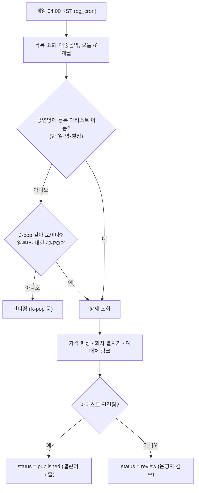

# 공연·아티스트 정보 오픈 API 조사

작성일: 2026-11-03 · 적용 위치: `supabase/functions/sync-concerts`, `sync-artists`, `_shared/kopis.ts`

인앱 상세 기획의 기준을 그대로 따랐다:

- 오픈 API를 쓸 수 있으면 적용하고 앱 안의 동작까지 설계한다.
- 유료 방식밖에 없으면 따로 적어 두기만 하고 적용하지 않는다.
- 쓸 수 있는 API가 아예 없으면 대안을 찾는다.

> 이용 조건·요금은 2026-11-03 기준이다. 각 서비스 약관을 계약·출시 전에 다시 확인할 것.

## 한눈에 보기

| 데이터 | 서비스 | 비용 | 판정 |
| --- | --- | --- | --- |
| 국내 공연 일정·장소·가격·포스터·예매처 링크 | **KOPIS 공연예술통합전산망** | 무료 (키 발급) | **적용** |
| 아티스트 목록·다국어 이름·별칭 | **MusicBrainz** | 무료 (CC0 데이터) | **적용** |
| 아티스트 이미지·장르·인기 순위 | Apple Music API | Apple Developer Program 연 $99 | 유료 → 기록만 (iOS 출시에 어차피 필요하므로 가입 후 재검토) |
| 아티스트 장르·인기도 | Spotify Web API | 개발 모드는 앱 소유자 Premium 구독 필요, 사용자 5명 제한 | 사실상 유료·제한 → 기록만 |
| 아티스트 사진 | fanart.tv | 개인 키 무료, 상업 이용은 별도 문의 | 기록만 (필요 시 문의) |
| 예매 오픈 일시 | 공개 API 없음 (NOL·멜론·YES24·티켓링크) | 제휴 계약 필요 | **대안: 운영자 입력** |
| 해외 공연 (참고) | Ticketmaster Discovery API | 무료 | 국내 내한 공연 커버리지 거의 없음 → 미적용 |
| 해외 투어 일정 | Bandsintown API | 아티스트·파트너 대상 승인제 | 기록만 |
| 지난 공연 세트리스트 | setlist.fm API | 비상업 무료, 상업은 문의 | 2차 기능 후보로 기록 |

---

## 1. KOPIS 공연예술통합전산망 (적용)

- **제공:** (재)예술경영지원센터. kopis.or.kr → 오픈 API → 이용 신청 → 서비스 키 발급(무료)
- **이용 조건:** 출처 표시 필수 → 캘린더 아래에 "공연 정보 일부 출처: …KOPIS" 문구를 넣었다
- **사용 엔드포인트** (기본 주소 `http://www.kopis.or.kr/openApi/restful`, 응답 XML)

| 용도 | 요청 | 쓰는 값 |
| --- | --- | --- |
| 공연 목록 | `/pblprfr?service=키&stdate=YYYYMMDD&eddate=YYYYMMDD&cpage=1&rows=100&shcate=CCCD` | mt20id, prfnm(공연명), prfpdfrom/to(기간), fcltynm(공연장), poster, area(지역) |
| 공연 상세 | `/pblprfr/{mt20id}?service=키` | prfcast(출연진), pcseguidance(가격), dtguidance(요일별 시각), relates(예매처 이름·링크) |

`CCCD`는 대중음악 장르 코드다. 목록 검색 기간은 오늘부터 6개월 뒤까지로 둔다.

**앱 안 동작 설계 (`sync-concerts`)**



- **회차:** `dtguidance`의 "토요일(18:00), 일요일(17:00)" 같은 안내를 읽어 기간 안의 요일마다 회차를 만든다. 읽을 수 없으면 날짜마다 19:00으로 둔다.
  - 같은 공연(KOPIS ID 하나)의 여러 회차는 캘린더에서 **선**으로 이어진다.
- **가격:** "R석 154,000원, S석 121,000원" → `price_min`/`price_max`. 검색의 가격 범주에 쓴다.
- **예매처:** `relates`의 링크가 공연 상세의 예매처 버튼이 된다. 누르면 외부 브라우저로 열린다.
- **운영자 보호:** 운영자가 숨긴 공연(`hidden`)과 직접 고친 공연(`source=admin`)은 다시 수집해도 덮어쓰지 않는다.
- **보관:** 마지막 회차로부터 `concert_retention_days`(기본 365일)가 지나면 정리 작업이 지운다. 인앱 기획의 "6개월~1년, 추후 조정"을 반영한 값이다.
- **한계:** KOPIS 장르는 대분류라 J-pop을 자동으로 정확히 고를 수 없다. 그래서 아티스트 이름 대조 + 운영자 검수를 함께 쓴다. **예매 오픈 일시는 KOPIS에 없다** → 6장 대안.
- **검증:** 파싱 함수는 `node --experimental-strip-types supabase/functions/_shared/kopis.test.ts`로 확인했다. 실제 키로 호출해 보는 것은 키 발급 후에 할 일이다.

### 로컬 수집 (Supabase 없이 웹에서 실제 데이터 보기)

```bash
pnpm fetch:opendata
```

- `.env`의 `KOPIS_API_KEY`로 위와 같은 규칙(`supabase/functions/_shared/kopis.ts`)을 로컬에서 돌려 `src/api/openData.json`에 저장한다. 데모 모드는 이 파일이 있으면 실제 공연·아티스트를, 없으면 샘플을 보여 준다.
- 요청을 연달아 보내면 KOPIS가 빈 응답이나 HTTP 400을 준다. 요청 사이에 간격을 두고 두 번까지 다시 시도하며, 목록이 중간에 끊기면 파일을 저장하지 않는다.
- 판별은 점수제다(`judgeConcert`, `supabase/functions/_shared/kopis.ts`). 서버 수집(sync-concerts)과 로컬 수집이 같은 코드를 쓴다.

| 근거 | 점수 |
| --- | --- |
| 출연진 칸에 아티스트 이름이 사람 단위로 정확히 있음 | +3 |
| 공연명에 고유한 이름 (여러 단어·8자 이상 영문, 3글자 이상 한글·일본어) | +2 |
| 공연명에 짧은 영문 이름만 (AI, YUKI 등) | +1 |
| 내한 공연 (KOPIS `visit=Y`) | +2 |
| 공연명 일본 표기·도쿄 등, 또는 출연진이 일본 이름 표기 (받침 ㄴ만, ㅐ·트·프 없음) | +1 |
| J-pop 공연 이력 기획사 (`JPOP_PROMOTERS`, 지금은 손으로 넣은 목록) | +1 |
| 출연진이 적혀 있는데 그 아티스트가 없고 한 단어 영문 이름으로만 맞음 (출연진이 일본 이름이고 고유한 이름이면 예외) | −3 |
| 국내 공연인데 짧은 이름만 맞음 | −2 |

  - 4점 이상 게시, 2~3점 검수 대기, 그 밖은 제외. 해외 공연(`area=해외`, 공연명 "[일본 …]")은 제외.
  - 아티스트를 못 찾아도 내한 공연에 일본 신호(일본 표기·일본식 이름·J-pop 기획사)가 있거나 공연명에 가나가 있으면 검수 대기. MusicBrainz 목록에 없는 아티스트를 놓치지 않기 위해서다.
  - 영문 이름은 단어 단위로만 맞춘다(Eve ≠ Event). 전각 영문(ＢＥＧＩＮ)·곡선 따옴표(Mu’s)도 NFKC로 바꿔 같은 규칙을 따른다. 두 글자 한글·일본어 이름은 쓰지 않는다.
- **정답 데이터로 채점:** `scripts/fixtures/`에 2026-11-04 후보 100건과 사람이 붙인 정답(J-pop 22, 아님 66, 애매 12)을 둔다. `pnpm test`가 오인(아닌데 게시) 0건, 누락(J-pop인데 제외) 0건을 확인한다. 결과: J-pop 22건 중 게시 9 · 검수 대기 13, 아닌 공연 66건 중 검수 대기 3 · 제외 63.
  - 정답 데이터를 다시 받으려면 `pnpm dump:kopis` 후 `scripts/fixtures/kopis-labels.json`에 정답을 붙인다.
- 남은 한계: 검수 대기의 오인 3건(데미안 라이스, LISA ONO, Morgenshtern)은 운영자가 거절한다. Yuki Kajiura 공연은 다른 가수 YUKI로 이어져 검수 대기로 남는다(운영자가 아티스트를 바로잡는다).
- **출처·고지:** 캘린더 아래 출처 문구, MY > 설정 > 앱 정보 > 오픈 API 화면에 KOPIS 고지 문구(집계기간·집계대상·인증키 안내)와 MusicBrainz 라이선스를 표시한다. 집계기간의 최종집계일은 마지막으로 받은 날짜다.

## 2. MusicBrainz (적용)

- **비용:** 무료. 데이터는 CC0(퍼블릭 도메인)이라 저장·표시 제한이 없다.
- **조건:** 초당 1회 이하 요청, 연락처가 담긴 User-Agent 필수. 상업적으로 대량 이용하면 MetaBrainz 후원(유료 지원 등급)을 권장한다.
- **요청:** `https://musicbrainz.org/ws/2/artist?query=tag:"j-pop" AND country:JP&fmt=json&limit=100&offset=…`
  - `j-rock` 태그도 같은 방식으로 받는다.
  - 2026-11-03 실측: `j-pop` + 일본 아티스트 1,519명이 나왔다.
- **저장:** `artists.mbid`, 한국어 이름, 일본어 이름, 영문 이름, 별칭(최대 20개).
  - 한국어 별칭은 locale 표시 없이 등록된 경우가 많다. 그래서 한글이 들어간 별칭도 한국어 이름으로 쓴다.
  - 별칭은 KOPIS 공연명 대조에 쓴다.
- **주기:** 매주 월요일 (`duckchinso-sync-artists` cron). 운영자가 고친 아티스트(`source=admin`)는 덮어쓰지 않는다.
- **한계:**
  - 이미지가 없다. 앱은 이름 첫 글자를 대신 보여 준다.
  - 인기 순서도 없다. 검색 결과는 관련도 순이라, 유명 아티스트를 위로 올리려면 운영자가 정렬값을 넣어야 한다(2차).

## 3. 유료라서 기록만 한 API

### Apple Music API (기획서 3.3 ⑧의 원래 1안)
- **필요:** Apple Developer Program(연 99달러) + MusicKit 키(.p8)
- **장점:** J-Pop 장르 차트(인기 순위), 아티스트 이미지, 다국어 이름
- **판단:** 유료 가입이 필요해 이번에는 적용하지 않았다. 다만 iOS 출시에 같은 계정이 필요하므로, 가입하면 추가 비용 없이 쓸 수 있다.
- **적용할 때:** `sync-artists`에 "장르 차트 → 아티스트 이미지·순위 보강" 단계를 더하면 된다. `artists.image_url` 열은 이미 있다.
- 약관상 메타데이터 저장 범위는 가입 후 확인해야 한다.

### Spotify Web API
- 2026-02-11부터 새 개발 모드 앱은 앱 소유자의 Premium 구독이 필요하다. Client ID는 1개, 사용자는 5명으로 제한된다.
- 정식 서비스에는 Extended Quota 심사가 필요하다.
- related artists, audio features는 2024년부터 새 앱에 막혀 있다.
- 판단: 비용·제한 때문에 미적용.

### fanart.tv
- 아티스트 사진을 MusicBrainz ID로 찾을 수 있어 2장과 궁합이 좋다.
- 개인 키는 무료지만 상업 앱은 별도 문의가 필요하다. 사진이 필요해지면 문의 후 적용한다.

## 4. 공개 API가 없어 대안을 마련한 것: 예매 오픈 일시

- NOL티켓(인터파크), 멜론티켓, YES24티켓, 티켓링크 모두 공개 API가 없다. 웹 페이지 크롤링은 이용약관 위반 소지가 있어 쓰지 않는다(기획서 7장).
- **대안 1 (적용):** 운영자 입력. `concerts.ticket_open_at`을 Supabase Studio에서 넣는다. 비어 있으면 앱은 "예매 일정 미정"이라고 보여 준다.
- **대안 2 (2차):** 사용자 제보. 공연 상세에 "예매 일정 알려주기"를 두고, 운영자 검수 후 반영한다.
- **대안 3 (2~3차):** 예매처 제휴. 트래픽을 입증한 뒤 데이터·제휴 링크 계약을 맺는다(수수료 BM, 기획서 11장).

## 5. 비용 정리

| 단계 | 월 비용(예상) | 내용 |
| --- | --- | --- |
| 지금 | 0원 | KOPIS·MusicBrainz 무료, Supabase Free(Edge Function·Cron 포함) |
| 출시 전후 | 약 3.5만원 + 연 13만원 | Supabase Pro($25/월, 일시정지 없음·백업). Apple Developer 연 $99 → Apple Music API 함께 사용 가능 |
| 사진·메일 | 0~3만원 | Resend 무료 월 3,000통, fanart.tv 상업 문의 |
