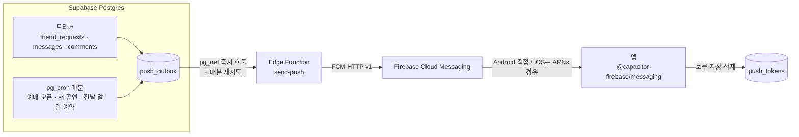

# 덕친소 푸시 알림 설계

작성일: 2026-11-05 · 기준: 기획서 3장 ⑥(FCM + @capacitor-firebase/messaging), 5.3 매칭 흐름, 9장 동의 항목, 정보통신망법 제50조, 현재 DB(`push_tokens`, `profiles.notify_enabled`, `favorites`, `concerts.ticket_open_at`)

## 1. 원칙

1. **내가 기다리는 일만 보낸다.** 누가 나에게 무언가를 했거나(요청·수락·채팅·댓글), 내가 찜한 공연에 시간이 됐을 때만 보낸다. 접속 유도("오랜만이에요"), 좋아요 수, 인기 글은 보내지 않는다.
2. **나쁜 소식은 보내지 않는다.** 거절·만료·차단·신고당함은 기획서 원칙(상대 미통지)대로 푸시도 없다.
3. **광고는 1차 출시에 보내지 않는다.** 광고성 푸시는 법적 형식(아래 5장)을 갖춘 기능만 만들어 두고, 실제 발송은 운영이 안정된 뒤 정한다.
4. **푸시를 꺼도 놓치는 것이 없게 한다.** 모든 알림의 원본은 앱 안(요청함, 채팅, 운영팀 대화방, 캘린더)에 남는다. 푸시는 그곳으로 가는 바로가기다.

## 2. 보낼 알림 (권고안)

| # | 종류 | 언제 | 제목 / 본문 예시 | 누르면 | 묶기·빈도 |
| --- | --- | --- | --- | --- | --- |
| 1 | 덕친 요청 받음 | 요청 즉시 | 덕친 요청 / `요네즈팬님이 덕친 요청을 보냈어요` | `/community/requests` | 요청마다 1건 (하루 한도가 있어 많지 않음) |
| 2 | 덕친 성립 | 상대가 수락한 즉시 (요청자에게) | 덕친이 됐어요 / `요네즈팬님과 덕친이 됐어요. 먼저 인사를 건네 보세요` | `/chats/:roomId` | 1건 |
| 3 | 새 채팅 | 메시지 즉시 | `요네즈팬` / 메시지 앞 40자, 사진은 `사진을 보냈어요` | `/chats/:roomId` | 대화방별로 하나로 묶음(Android `tag`, iOS `thread-id`). 그 방을 보고 있으면 띄우지 않음 |
| 4 | 운영팀 메시지 | 문의 답변·제재 고지가 운영팀 대화방에 올라온 즉시 | 덕친소 운영팀 / `문의하신 내용에 답변이 도착했어요` | 운영팀 대화방 | 3번과 같은 채팅 경로를 쓴다. 제재 내용은 잠금화면에 그대로 보이지 않게 본문을 고정 문구로 |
| 5 | 내 글에 댓글 | 댓글 즉시 | 새 댓글 / `요네즈팬님: 저도 그날 가요!` | `/community/post/:id` | 글별로 묶음. 내가 단 댓글은 제외 |
| 6 | 관심 공연 예매 오픈 | 찜한 공연의 `ticket_open_at` **하루 전 20시**와 **30분 전** | 예매 오픈 30분 전 / `요네즈 켄시 내한 공연 예매가 20:00에 열려요` | `/concert/:id` | 공연당 최대 2번 |
| 7 | 관심 아티스트 새 공연 | 관심 아티스트의 공연이 공개(published)된 다음 날 12시 | 새 공연 / `요네즈 켄시 외 1팀의 새 공연이 등록됐어요` | 1건이면 `/concert/:id`, 여러 건이면 `/calendar` | **하루 1번으로 묶음** |
| 8 | 공연 전날 | 찜한 공연 회차 전날 19시 | 내일 공연 / `내일 18:00 요네즈 켄시 공연이에요. 장소: KSPO DOME` | `/concert/:id` | 회차당 1번 |

**권고 우선순위:** 1·2·3·4는 출시 필수다. 매칭 성립 푸시는 기획서 5.3에 명시돼 있다. 6은 동의서에 적힌 기능이라 함께 넣는다. 5·7·8은 Apple 4.2(앱다운 기능) 대응에도 도움이 되지만, 일정이 빠듯하면 7·8은 출시 직후로 미룰 수 있다.

### 보내지 않는 것

| 종류 | 이유 |
| --- | --- |
| 요청 거절·만료 | 기획서: 거절은 상대에게 알리지 않음, 만료는 요청자 화면에 "응답 없음"으로만 |
| 차단·신고 접수 | 상대 미통지 원칙. 신고자에게 처리 결과 푸시도 보내지 않는다(악용·보복 방지) |
| 추천(좋아요) | 소음. 앱 안 숫자로 충분 |
| 접속 유도, 인기 글, 추천 덕친 | 정보통신망법상 광고성 정보로 볼 여지가 있다(서비스 이용 권유). 광고 동의 없이 보내면 위반 |
| 운영자 앱 알림 (새 신고·문의) | 1차는 운영자 화면 배지로 충분. 필요해지면 운영자 전용 알림으로 별도 추가 |

## 3. 시간대와 수신 조건

- **즉시 알림(1~5):** 사람이 방금 한 행동의 결과라 시간 제한 없이 보낸다. 광고가 아니므로 야간 제한 대상이 아니다.
- **예약 알림(6~8):** 09:00~21:00(한국 시간)에만 보낸다. 예외: 예매 오픈 30분 전 알림은 예매 시간이 밤이어도 보낸다(사용자가 찜으로 요청한 정보다).
- **받는 조건 (전부 만족해야 발송):**
  1. 기기 알림 권한 허용 + `push_tokens`에 토큰 있음
  2. `consents`의 `push` 최신 값이 동의 **그리고** `profiles.notify_enabled = true` (설정 화면 토글이 이미 둘을 함께 바꾼다)
  3. 받는 사람 `profiles.status`가 `banned`가 아님
  4. 보낸 사람을 받는 사람이 차단하지 않았음 (채팅·요청은 이미 막혀 있지만 댓글은 따로 확인)
- 비회원(익명 계정)도 받을 수 있다. 회원으로 전환하면 같은 user_id라 토큰이 그대로 이어진다.
- **2차 후보:** 종류별 켜고 끄기(채팅만 끄기 등), 방해 금지 시간, iOS 앱 아이콘 배지 숫자.

## 4. 알림 권한 요청 시점

앱 첫 실행 때 바로 OS 권한 창을 띄우지 않는다(거절되면 다시 띄울 수 없고, iOS 허용률도 크게 떨어진다).

1. 동의 화면의 "서비스 알림 수신(선택)"은 **우리 서비스의 동의**일 뿐, OS 권한은 아직 묻지 않는다.
2. 다음 중 처음 일어나는 순간에 안내 시트 → OS 권한 창 순서로 묻는다.
   - 덕친 요청을 처음 보냈을 때: "상대가 수락하면 알려 드릴까요?"
   - 공연을 처음 찜했을 때: "예매가 열리기 전에 알려 드릴까요?"
   - 설정에서 서비스 알림 토글을 켰을 때
3. OS 권한이 거절된 상태에서 토글을 켜면 "기기 설정에서 알림을 허용해 주세요"와 설정 열기 버튼을 보여 준다.

## 5. 광고성 푸시 (2차, 법적 형식만 정의)

정보통신망법 제50조 기준. 1차 출시에는 발송하지 않는다.

- `marketing` 동의자에게만, 21:00~08:00은 `nightMarketing` 동의자에게만
- 제목 맨 앞에 `(광고)`, 본문에 보낸 곳(덕친소)과 수신 거부 방법(MY > 설정 > 광고성 정보 수신)을 적는다
- 동의 후 **2년마다 수신 동의 여부를 다시 알려야 한다**(동의 일자·유지 사실 안내). 광고 발송을 시작할 때 정기 작업으로 함께 만든다
- 수신 거부·철회 처리 결과를 14일 안에 알린다(설정 화면 토스트로 즉시 처리됨)

## 6. 구조

### 서버

- **`push_outbox` 테이블(새로 만듦):** `id, user_id, kind, title, body, path, group_key, send_after, sent_at, attempts, created_at`
  - 트리거와 정기 작업은 여기에 줄만 넣는다. 발송은 함수 한 곳에서만 한다.
  - 같은 알림이 두 번 가지 않게 `(user_id, kind, dedupe_key)` 유일 키를 둔다. 예: 예매 오픈은 `concert_id + 'd-1'`.
  - 사용자는 이 테이블을 읽거나 쓰지 못한다(RLS 전부 차단, 서버 함수만).
- **트리거(즉시 알림):**
  - `friend_requests` insert → 1번
  - `friend_requests` 수락으로 update → 2번
  - `messages` insert → 3·4번. 받는 쪽 대화방 멤버마다 1줄. system 메시지는 제외
  - `comments` insert → 5번
  - 넣은 직후 `pg_net`으로 `send-push`를 바로 부른다(기존 정기 수집과 같은 Vault 키 방식). 실패해도 매분 재시도가 다시 집어 간다.
- **정기 작업(예약 알림):** 매분 `enqueue_scheduled_push()`가 6·7·8번 대상을 찾아 `send_after`를 정해 넣는다. 매분 한 번 `send-push`를 불러 `send_after`가 지난 미발송 줄을 보낸다.
- **`send-push` 함수(새로 만듦):**
  1. 미발송 줄을 최대 500개 가져와 3장의 수신 조건을 확인한다.
  2. FCM HTTP v1로 보낸다. 데이터에 `path`와 `group_key`를 담는다.
  3. FCM이 `UNREGISTERED`/`INVALID_ARGUMENT`를 돌려주면 그 토큰을 `push_tokens`에서 지운다.
  4. 성공·조건 불충족은 `sent_at`을 기록하고, 일시 오류는 `attempts`를 늘린다(3회 넘으면 포기).
  - 비밀값: Firebase 서비스 계정 JSON을 함수 시크릿 `FIREBASE_SERVICE_ACCOUNT`로 등록한다(사용자가 직접 붙여 넣음).
- **보관:** `run_maintenance()`에서 발송 후 7일 지난 `push_outbox` 줄을 지운다.

### 앱

- 플러그인은 `@capacitor-firebase/messaging` **하나만** 쓴다(기획서 충돌 방지 규칙). Firebase Auth는 설치하지 않는다.
- 로그인 직후, 그리고 권한이 허용돼 있으면 앱을 열 때마다 토큰을 받아 `push_tokens`에 upsert한다. 토큰이 바뀌면 다시 upsert한다.
- 로그아웃·탈퇴 때 그 기기의 토큰을 지운다. 탈퇴는 `on delete cascade`로 이미 지워진다.
- 알림을 누르면 `path`로 이동한다. 앱이 꺼져 있었으면 스플래시 → 로그인 확인 → 그 경로로 간다.
- 앱을 보고 있을 때 온 알림은 OS 배너 대신 앱 안 토스트로 보여 준다. 지금 보고 있는 채팅방의 알림이면 아무것도 띄우지 않는다.
- 웹(브라우저)은 1차에서 푸시를 받지 않는다(`platform='web'`은 2차).

## 7. 준비할 것 (사용자)

| 할 일 | 비고 |
| --- | --- |
| Firebase 프로젝트 생성, Android·iOS 앱 등록 | 앱 ID가 확정돼야 등록 가능 |
| `google-services.json`, `GoogleService-Info.plist` 받기 | 각각 `android/app/`, `ios/App/App/`에 둔다. 저장소에 올려도 되는 공개 설정 파일이다 |
| APNs 인증 키(.p8) 만들어 Firebase에 등록 | Apple Developer 가입 후. iOS 푸시는 이게 없으면 오지 않는다 |
| Firebase 서비스 계정 키 → Supabase 함수 시크릿 | 비밀값. 직접 붙여 넣기 |
| iOS Xcode 프로젝트에 Push Notifications·Background Modes(remote notification) 켜기 | Codemagic 빌드 전에 한 번 |
| 개인정보처리방침에 **처리 위탁·국외 이전** 추가 | FCM(Google LLC, 미국)으로 푸시 토큰과 알림 문구가 전송된다. Supabase 서버 지역도 함께 적는다. 법률 검토 항목 |

## 8. 개발 순서

1. 마이그레이션: `push_outbox`, 트리거 4개, `enqueue_scheduled_push()`, 정기 작업, 보관 정리
2. `send-push` Edge Function (FCM v1 토큰 발급 + 발송 + 무효 토큰 삭제)
3. 앱: 플러그인 설치, 토큰 저장·삭제, 권한 요청 시트, 알림 눌러 이동, 앱 안 토스트
4. DB 테스트: 차단·동의 철회·제재 계정은 줄이 생겨도 발송 안 됨, 예매 오픈 알림 중복 없음, 거절·만료는 줄이 안 생김
5. 실기기 확인: Android 13+ 권한 창, iOS TestFlight에서 수신·묶기·눌러 이동
